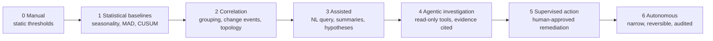
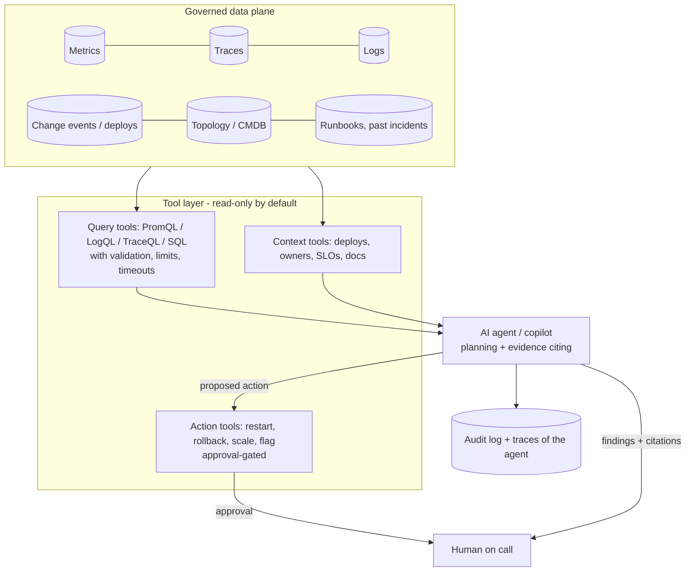

# AI for observability

Using AI (statistical models, ML, LLMs, agents) to help detect, understand and resolve problems in any system. Also called **AIOps** or **AI SRE** when it extends to incident response.

!!! info "Product facts"
    Vendor products in this space launched and renamed quickly in 2025-2026, and many public comparisons are written by competitors. Statuses below are from vendor announcements and secondary reviews as of October 2026. **Verify GA/preview status, pricing and accuracy claims with the vendor and your own pilot.**

## What AI can do for observability

| Capability | Typical technique | Maturity | Value |
|---|---|---|---|
| **Anomaly detection** | Seasonal baselines, robust statistics, CUSUM, forecasting, unsupervised ML | High (proven) | Fewer static-threshold pages, earlier shifts |
| **Alert noise reduction** | Dedup, grouping by topology/time, suppression, correlation | High | Less fatigue |
| **Change correlation** | Join deploy/config/prompt/model events to metric shifts | High | Fast "what changed?" |
| **Causal / topology RCA** | Dependency graph + causal reasoning (e.g. Dynatrace Davis-style causal AI) | Medium-high | Root-cause candidates through the service graph |
| **Natural-language querying** | LLM translating questions to PromQL/LogQL/KQL/SQL/TraceQL | Medium | Lower barrier; needs validation of generated queries |
| **Investigation agents ("AI SRE")** | LLM agents forming and testing hypotheses against live telemetry, tickets, code, runbooks (e.g. AWS DevOps Agent, Datadog's Bits investigation, Azure SRE Agent, Google Cloud Assist investigations, CloudWatch Omni investigations) | Medium (GA in several clouds in 2026; quality varies) | Faster triage, shared incident timelines |
| **Summarization** | LLM summaries of incidents, traces, logs, postmortems | Medium-high | Handoffs, status updates |
| **Remediation** | Runbook automation, suggested fixes/PRs, auto-rollback | Low-medium, high risk | Lower MTTR, only with guardrails |
| **Instrumentation assistance** | LLM agents adding OTel instrumentation (for example "auto-instrument with Kiro") | Medium | Faster onboarding; review the generated code |
| **Capacity/cost forecasting** | Time-series forecasting | High | Budgeting, headroom alerts |
| **Log/trace clustering** | Embeddings, template mining | Medium-high | Find unknown unknowns |

## Maturity ladder: climb it in order



**Rule:** each rung must beat the one below it on *your* history before you adopt it. Most teams get most of the value from rungs 1-3.

### Runnable baseline: statistics before LLMs

[`examples/aiops/anomaly_baseline.py`](https://github.com/akashtalole/ai-observability/blob/main/examples/aiops/anomaly_baseline.py) compares detectors on an hourly cost series with daily/weekly seasonality and three injected incidents (level shift, spike, slow drift):

```text
static threshold 1.3x   alerts= 30  detected=3/3  false alerts=23  mean delay=  7.0 h
static threshold 1.6x   alerts=  5  detected=3/3  false alerts= 0  mean delay= 24.7 h
seasonal baseline + MAD alerts=  1  detected=1/3  false alerts= 0  mean delay=  2.0 h
seasonal baseline + CUSUM alerts= 3 detected=3/3  false alerts= 0  mean delay= 15.0 h
```

Reading it honestly: a low threshold pages constantly, a high one is late, MAD is fast on spikes but misses slow shifts, CUSUM catches shifts sooner than the high threshold with no false alerts. The gains are real but **modest and incident-shape dependent**, and they need no training data. That is the bar any ML/LLM feature has to clear on your own incident history. The same detectors apply to AI-app quality and cost series (groundedness, cost per request).

## Architecture for AI assistants over observability data



Design rules:

1. **Read-only first.** Start with query/context tools only. Add actions one at a time, each with its own risk review.
2. **Evidence or it did not happen.** Every claim in an investigation must cite a query/result/trace the human can open. Reject answers without citations.
3. **Constrain query generation.** Validate generated PromQL/LogQL/SQL (syntax, cost, time range, row limits), run with timeouts and read-only credentials.
4. **Least-privilege identity.** The agent gets scoped, short-lived credentials per tool; tenant and data-classification boundaries apply to it as to any user.
5. **Context quality beats model size.** Topology, ownership, SLOs, change events and clean runbooks are what make investigations correct. Garbage metadata means confident nonsense.
6. **Human approval for state changes**, with a diff/plan shown and a rollback path; start with reversible, low-blast-radius actions.
7. **Everything the agent does is logged and traced** ([meta-observability](meta-observability.md)).

## Data governance

| Concern | Control |
|---|---|
| **Sensitive data in telemetry** (prompts, PII, secrets) | Redact at the Collector before any AI assistant can read it; apply the [content policy](../architecture/security-privacy.md) to the assistant's access |
| **Where the model runs** | Vendor-hosted vs your cloud account vs self-hosted; check residency, retention, "no training on customer data" |
| **Cross-tenant leakage** | Assistant queries inherit the user's/tenant's authorization, never a superuser |
| **Prompt injection via telemetry** | Logs, error messages and ticket text are untrusted input to the agent: treat as data, strip instructions, constrain tools |
| **Audit** | Immutable record of questions, queries, evidence, proposed and executed actions, approver |

## Evaluating an AI-for-observability tool (pilot design)

You need evaluation too, and it looks different from app evaluation.

| Step | What to do |
|---|---|
| **Build an incident corpus** | 30-100 past incidents with ground truth: root cause, timeline, the signals that revealed it, the fix. Include hard and ambiguous ones, and some "no action needed" cases |
| **Replay** | Give the tool the telemetry/context as of the incident time (read-only snapshot or replay environment); measure what it concludes |
| **Score** | Top-1/top-3 **root-cause accuracy**; **evidence validity** (are citations real and supportive?); time to first useful hypothesis; **false-confidence rate** (wrong answers stated confidently); unsafe-action proposals; investigation cost |
| **Compare to baselines** | A senior SRE with normal tools, and the statistical/correlation rungs below it |
| **Shadow mode** | Run on live incidents without acting; humans grade usefulness afterward |
| **Measure outcomes** | MTTD, MTTR, escalations avoided, alert volume, on-call satisfaction, and **errors introduced** |
| **Segment** | By incident type, service tier, data quality; averages hide where it fails |

Use the [scoring](../scoring/index.md) discipline: paired comparisons, intervals, calibrated judges for subjective grades, versioned rubrics, and re-run when the vendor updates the model.

## Cost, ROI and procurement

* Pricing models vary: per agent-second or "agent unit", per investigation, credit-based, seat-based, or bundled. Model cost per incident and per month at your incident volume, including **runaway or looping agent** scenarios.
* ROI is toil and MTTR, but count **verification time**: if engineers must recheck every claim, the saving shrinks. Track "accepted without edits" rate.
* Beware bundling: an assistant that only works well with one vendor's data layer is a lock-in decision. Prefer tools that consume OpenTelemetry-native data and expose their tool interfaces (for example via MCP) so you can swap.
* Check SLAs for the assistant itself: on-call must still work when it is down.

## Landscape (by category, October 2026)

| Category | Examples | Notes |
|---|---|---|
| **Cloud-native investigation agents** | AWS DevOps Agent (reported GA Mar 2026; inside [CloudWatch Omni](../cloud-native/omni.md) sessions), Azure SRE Agent, Google Gemini Cloud Assist investigations | Deep access to the provider's telemetry and resources; provider-centric |
| **APM/observability platform AI** | Datadog (Bits AI investigation), Dynatrace (Davis causal AI; SRE agent workflows reported in preview), New Relic, Grafana, Elastic, Splunk | Best when your data already lives there |
| **Dedicated AI SRE vendors** | Several startups; consolidating quickly | Verify viability and data handling; ask for incident-replay results |
| **Incident-management AI** | PagerDuty and similar: triage, summaries, runbook automation | Integrates paging and workflow |
| **Open-source / DIY** | LLM + MCP servers for Prometheus/Loki/Tempo/Grafana + your runbooks | Control and portability; you own evaluation and safety |
| **Anomaly/forecasting libraries** | Prophet-style forecasting, robust-statistics libraries, Grafana/Prometheus ML features | Cheap, explainable first step |

## Anti-patterns

| Anti-pattern | Why it hurts |
|---|---|
| Buying an "AI SRE" before fixing telemetry, ownership and runbooks | Garbage in, confident garbage out |
| Letting the agent act on production on day one | Unbounded blast radius; no trust yet |
| Trusting accuracy numbers from vendor demos | Different incidents, curated data |
| Unvalidated generated queries against production stores | Expensive scans, wrong answers |
| One super-user credential for the agent | Cross-tenant exposure, privilege escalation by prompt injection |
| No baseline comparison | You cannot tell if AI beats a CUSUM and a good dashboard |
| Using AI to alert on AI quality with no calibration | Circular: an uncalibrated judge pages you about its own noise |
| Treating its output as ground truth in postmortems | Humans own root cause; the agent's hypothesis is input |

## Adoption checklist

- [ ] Telemetry contract, change events, topology and ownership data in place
- [ ] Statistical baselines and alert grouping deployed first (rungs 1-2)
- [ ] Incident corpus built; baseline human performance measured
- [ ] Pilot in read-only shadow mode; scored on accuracy, evidence validity, false confidence
- [ ] Data-access, residency and redaction reviewed; least-privilege tool identities
- [ ] Action tools approval-gated, reversible, audited
- [ ] The assistant itself is traced, costed and alerted ([meta-observability](meta-observability.md))
- [ ] Exit plan: tools and data remain portable
