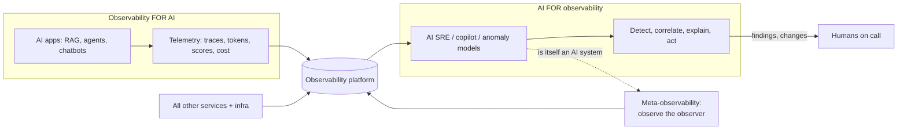

# AI for observability vs observability for AI

Two phrases that sound alike and are easy to conflate:

| | **Observability *for* AI** | **AI *for* observability** |
|---|---|---|
| **Direction** | Observe AI systems | Use AI to do observability work |
| **Subject** | LLM apps, RAG, agents, chatbots, models | Your telemetry, incidents, alerts, dashboards, on-call |
| **Question** | "Is my AI application fast, correct, safe and affordable?" | "Can AI help me detect, triage, explain and fix problems faster?" |
| **Typical outputs** | Traces of prompts/tools, token and cost metrics, quality scores, guardrail verdicts | Anomaly alerts, correlated incident timelines, root-cause hypotheses, natural-language queries, generated runbooks/PRs |
| **Data it needs** | Telemetry about the AI workload (with content policy) | Telemetry about **any** workload, plus topology, deploys, tickets, runbooks |
| **New problem it creates** | Non-deterministic behavior needs evaluation, not just status codes | The helper is itself non-deterministic, can be wrong, and has access to production data |
| **Who owns it** | Platform + AI/ML + product teams | SRE / platform / observability team |
| **Success metric** | Latency, quality, cost, safety SLOs for the AI app | MTTD, MTTR, alert noise, investigation accuracy, toil saved |
| **Core of this handbook** | Almost everything: [telemetry model](../fundamentals/telemetry-model.md), [metrics](../metrics/metrics-catalog.md), [scoring](../scoring/index.md), [use cases](../use-cases/index.md) | [AI for observability](ai-for-observability.md), this section |

## The four combinations

| | Observed system is **not AI** | Observed system **is AI** |
|---|---|---|
| **No AI in the loop** | Classic APM / SRE | **Observability for AI** (the bulk of this handbook) |
| **AI in the loop** | **AI for observability** on conventional services (AIOps) | Both at once: AI helping observe AI. Highest leverage, and highest risk of circular reasoning |

Most enterprises will live in the bottom-right quadrant within a year: AI apps in production *and* AI assistants triaging their incidents. That is why the boundary matters.

## Why you must keep them separate in your thinking

1. **Different failure modes.** An AI app fails by being plausibly wrong; an AI SRE agent fails by being confidently wrong about *your infrastructure*, possibly with the ability to change it.
2. **Different data rights.** Observability for AI deals with user content and prompts; AI for observability reads logs, configs, tickets and secrets-adjacent data across the estate.
3. **Different evaluation.** The first needs [scorers and golden sets](../scoring/index.md) for answers; the second needs replayed incidents, accuracy of root-cause hypotheses and action safety.
4. **Different blast radius.** A bad chatbot answer harms one user; a bad automated remediation can take down a region.
5. **Different buyers and budgets.** Platform/AI teams vs SRE/operations; don't let one purchase silently define the other.

## Where the two meet (and what to watch)

* **AI observing AI.** Using an LLM judge to score another LLM's answers ([online scoring](../scoring/online-scoring.md)) is AI-for-observability applied to observability-for-AI. Calibrate the judge, avoid same-model self-grading, version it.
* **AI SRE investigating AI-app incidents.** It needs the AI-specific context: prompt/model/index versions, retrieval health, eval scores, change events. Without them it will blame infrastructure for what is a prompt regression. Give it the [telemetry contract](../cloud-native/implementation-guide.md#4-the-telemetry-contract).
* **Observing the observers.** Every AI SRE agent, copilot and judge is an AI application and needs the same tracing, cost, quality and safety visibility: see [Meta-observability](meta-observability.md).
* **Shared plumbing.** OpenTelemetry, a Collector tier, a long-range store, a runbook library: the same foundations serve both.

## Reading guide

| If you are… | Read |
|---|---|
| An AI/ML or platform engineer shipping AI apps | The rest of the handbook, starting at [Why AI observability](../fundamentals/why-ai-observability.md) |
| An SRE/observability lead evaluating AI assistants | [AI for observability](ai-for-observability.md) |
| Responsible for both, or for governance | [Meta-observability](meta-observability.md) and the [cloud-native guide](../cloud-native/index.md) |
