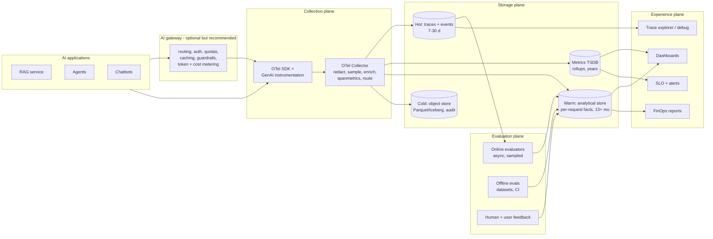
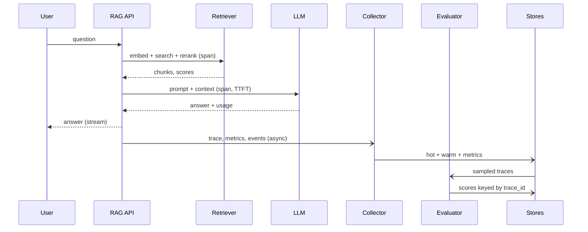

# Reference architecture

A vendor-neutral architecture that delivers **real-time visibility and multi-month trends** for latency, quality and cost.

## Planes and responsibilities

| Plane | Responsibility | Typical components |
|---|---|---|
| **Application** | Emit spans, metrics and events with business context | OTel SDK, OpenLLMetry/OpenInference/OpenLIT, vendor SDK |
| **Gateway** | Single choke-point for model calls: auth, quotas, retries, fallbacks, caching, metering | LiteLLM, Portkey, Kong, Cloudflare, APIM, Envoy AI Gateway, TensorZero |
| **Collection** | Vendor-neutral pipeline: batching, redaction, tail sampling, enrichment, fan-out | OpenTelemetry Collector (contrib) |
| **Evaluation** | Turn content into quality scores, async and sampled | Ragas, DeepEval, TruLens, Phoenix evals, LLM-as-judge, platform evaluators |
| **Storage** | Tiered: hot traces, warm analytical facts, metrics rollups, cold archive | ClickHouse, Tempo/Jaeger, Prometheus/Mimir/VictoriaMetrics, S3/ADLS/GCS + Iceberg |
| **Experience** | Dashboards, alerting, exploration, cost reports, review queues | Grafana, vendor UI, Superset/Metabase, PagerDuty |

## Key design decisions

1. **Gateway or no gateway?** A gateway gives uniform metering and policy for *all* model traffic; it is the easiest place to get cost and rate-limit visibility. Instrumenting in-app gives richer *semantic* context (retrieval, prompt versions). Most enterprises do both: gateway for metering/policy, app SDK for semantics, joined by `traceparent`.
2. **Evaluation off the hot path.** Never block the user request on an LLM judge. Emit trace → evaluate asynchronously → write scores back keyed by `trace_id`.
3. **Two stores, two jobs.** Traces optimize for *debugging a single request* (short retention, high detail). A wide **per-request fact table** optimizes for *trend analysis* (long retention, columnar, cheap aggregates). Do not try to serve month-over-month analytics from a trace backend.
4. **Rollups for long ranges.** Dashboards over 6–18 months must read pre-aggregated data (see [Storage & retention](storage-and-retention.md)).
5. **Release annotations.** Every deploy, prompt version, model change, index rebuild writes an annotation/event so a trend shift can be tied to a cause.

## Request-level data flow (RAG example)

## Deployment topologies

| Topology | Description | Fit |
|---|---|---|
| **SaaS only** | SDK → vendor SaaS | Small teams, fastest time to value; data-residency and cost at scale are the risks |
| **Collector + SaaS** | SDK → your Collector (redact/sample) → SaaS | Good default for regulated buyers; keeps portability |
| **Self-hosted OSS** | Collector → Langfuse/Phoenix/OpenSearch/ClickHouse in your VPC | Data control; you operate it |
| **Hybrid** | APM for ops signals + LLM platform for evals/prompts + warehouse for cost/trend | Common enterprise end state |
| **Cloud-native** | Provider services (Azure Monitor/App Insights + Foundry, CloudWatch + AgentCore, Cloud Monitoring/Trace + Vertex) | Single-cloud estates |
