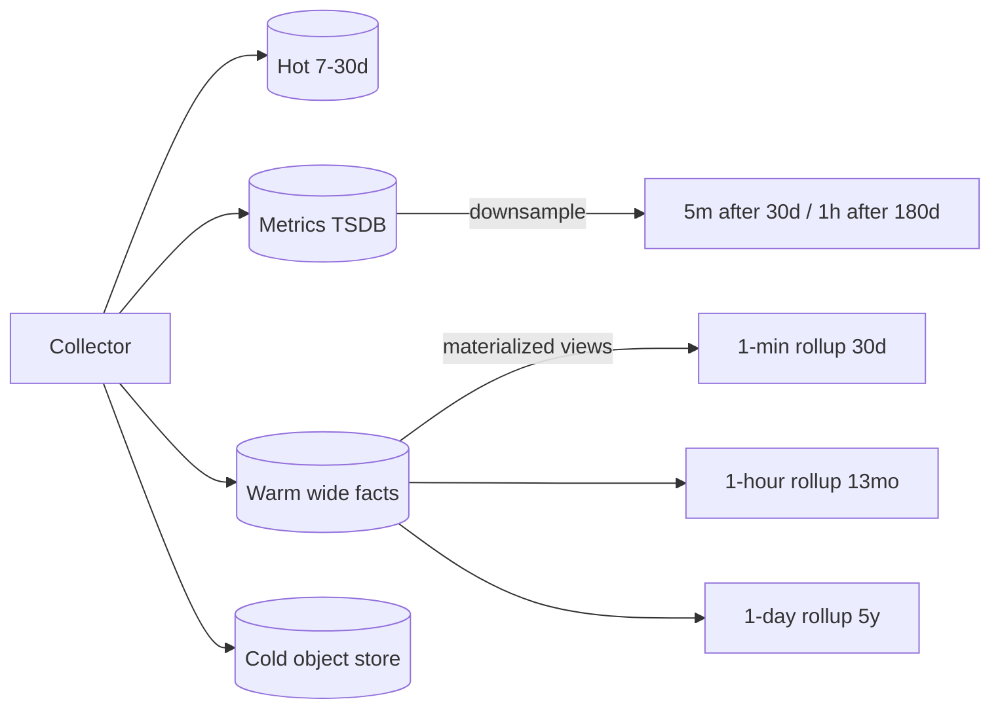

# Storage, retention & long-range trends

Requirement: *"see latency, quality and cost across **any time range** and track trends over **months**."* That drives a tiered design — no single store is good at both per-request debugging and 18-month trends.

## Tiers

| Tier | Holds | Retention (typical) | Store options | Serves |
|---|---|---|---|---|
| **Hot** | Full traces, spans, events (sampled content) | 7–30 days | Tempo/Jaeger, ClickHouse, OpenSearch, vendor SaaS | Debugging one request, live tail |
| **Warm** | **Wide per-request facts** (latency by stage, tokens, cost, versions, eval scores, outcome) | 13–24 months | ClickHouse, BigQuery, Snowflake, Databricks, Synapse/Fabric, Athena | Slice-and-dice, cohort & trend analysis, FinOps |
| **Metrics** | Pre-aggregated counters/histograms | 13+ months with downsampling | Prometheus + Mimir/Thanos/VictoriaMetrics, Datadog, CloudWatch | Dashboards, SLOs, alerts |
| **Cold** | Raw telemetry + governed content | Per policy (1–7 y) | S3/ADLS/GCS as Parquet/Iceberg/Delta | Audit, re-processing, legal hold |



## Why a wide fact table

One row per request/turn means any question — "p95 retrieval latency by index version for tenant X in March" — is a single `GROUP BY`. Metrics TSDBs cannot answer high-cardinality questions (tenant × prompt × model) cheaply; traces cannot do cheap aggregates over months.

See the schema in [`examples/sql/clickhouse_schema.sql`](https://github.com/akashtalole/ai-observability/blob/main/examples/sql/clickhouse_schema.sql) and queries in [Dashboards & queries](../rag/dashboards-and-queries.md).

## Rollups and percentiles

* Store **histogram/quantile states** (`quantilesTDigest`, `quantileState`, or Prometheus native/classic histograms) in rollups. **Never average percentiles** — merge their states.
* Keep three granularities: 1-minute (alerting, ≤30 d), 1-hour (weeks–months), 1-day (quarters–years).
* Roll up *by dimension sets* you actually need: `{app, env}`, `{app, tenant}`, `{app, model}`, `{app, prompt_version}`, `{app, index_version}`.
* Cardinality guardrails: never put `user_id`, `trace_id`, or raw query text on metric labels. Tenant is acceptable only with a bounded tenant list (use top-N + "other").

## Sampling strategy

| Traffic | Strategy |
|---|---|
| Errors, guardrail hits, slow (> p95), low eval score, thumbs-down | **Keep 100%** (tail-based sampling) |
| High-value tenants / regulated flows | Keep 100% of metadata; sample content |
| Healthy bulk traffic | 1–10% for full traces; **100% for the wide fact row and metrics** |
| Online evaluation | Stratified sample (per tenant/feature/intent), e.g. 2–5% + all flagged traces |

Always compute metrics from **unsampled** data (Collector `spanmetrics`/`signaltometrics` before the sampler, or app-side metrics) so rollups are not biased.

## Sizing back-of-envelope

```text
requests/day   × avg spans/request × ~1 KB/span   = hot-tier bytes/day
requests/day   × ~1–2 KB wide row (compressed 5–10x) = warm-tier bytes/day
content bytes  = requests × (prompt+context+answer chars) — dominant; gate with policy
```

Example: 5 M requests/day × 15 spans × 1 KB = 75 GB/day raw traces (before compression and sampling) — which is why full-trace retention is days, not months, while the wide row (≈10 GB/day raw, ≈1–2 GB compressed) comfortably covers 18 months.

## Time-range UX requirements

* Dashboards pick the **rollup granularity from the selected range** (≤6 h → 1-min; ≤14 d → 1-hr/5-min; >14 d → 1-hr/1-day).
* Always show **release/prompt/model/index annotations** on the time axis.
* Provide **period-over-period** (week-over-week, month-over-month) and **baseline bands** (rolling 28-day median ± MAD).
* Retain **eval scores** at the same granularity as latency so quality and latency can be viewed together.
