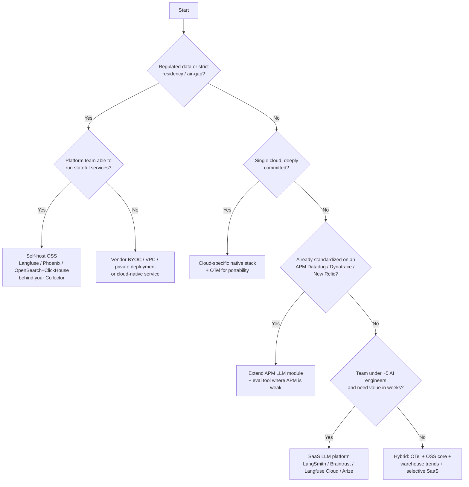

# Build vs Buy: decision framework

"Build vs buy" for AI observability is rarely binary. Decompose the stack and decide **per layer**.

## Decompose first

| Layer | Commodity? | Usual call |
|---|---|---|
| Instrumentation (SDK, semconv) | Yes — standards exist | **Adopt** OpenTelemetry + auto-instrumentation; build a thin wrapper for your `app.*` attributes |
| Collection pipeline | Yes | **Adopt OSS** OTel Collector (run it yourself) |
| Trace / metric storage | Yes | Buy (APM/SaaS/cloud) **or** run OSS (ClickHouse, Tempo, Prometheus) |
| LLM-aware UI (trace viewer, prompt playground, datasets) | Semi | **Buy or adopt OSS** (Langfuse, Phoenix, LangSmith…) |
| Evaluation framework | Semi | Adopt OSS evaluators (Ragas, DeepEval, TruLens); **build** domain-specific judges and golden sets |
| Cost attribution & FinOps | Company-specific | **Build** thin layer on gateway/telemetry + your billing/tenant model |
| Wide fact table & trend analytics | Company-specific | **Build** in your warehouse/lakehouse (you already own that stack) |
| Governance, redaction policy | Company-specific | **Build** policies; buy/adopt detectors |

!!! success "Pragmatic default"
    **Adopt** standards (OTel) → **Buy/adopt** an LLM-aware platform for traces/evals/prompts → **Build** the thin, company-specific layer (cost attribution, wide-fact trends, governance) on infrastructure you already run.

## Decision flow

## Weighted scoring

Score each option 1–5 per criterion; multiply by weight (adjust weights to your context). The interactive version is in the [HTML decision tool](../artifacts/index.md).

| Criterion | Default weight | Questions |
|---|---|---|
| Time to value | 15 | Weeks vs quarters to first useful dashboard? |
| Data control & residency | 15 | Can content stay in our VPC/region? BYOK? |
| Total cost of ownership at 3× scale | 15 | See [TCO](tco.md); does pricing scale with spans, events, seats, tokens? |
| LLM-native depth | 15 | Prompt mgmt, datasets, evals, agent traces, RAG views |
| Portability / lock-in | 10 | OTel ingest *and* export? Data export API? |
| Integration with existing stack | 10 | SSO, alerting, ticketing, APM correlation |
| Long-range trend & cost analytics | 10 | Retention, rollups, SQL access to raw data |
| Operability burden | 5 | Who is on call for it? |
| Vendor viability | 5 | Ownership changes, roadmap, license stability |

## Triggers to revisit the decision

* Observability spend > 10–15 % of the AI platform spend.
* Vendor acquired / relicensed / enters maintenance mode (this has happened repeatedly in the category).
* Move to multi-cloud or sovereign-cloud requirement.
* Span/event volume grows 5× (pricing cliffs).
* New regulation requiring on-prem evidence retention.

## Anti-patterns in the decision

1. **Building a trace UI from scratch** — OSS options are mature; build only the differentiating layer.
2. **Buying a platform but skipping instrumentation standards** — creates lock-in at the SDK level.
3. **Evaluating tools on demos, not on your traces** — run a 2-week bake-off on real (redacted) traffic with a scorecard.
4. **Ignoring exit cost** — require a data-export path and OTel compatibility in the contract.

## Bake-off plan (2 weeks)

1. Pick 2–3 candidates covering different archetypes (e.g. SaaS, OSS self-host, cloud-native).
2. Instrument one real RAG flow through the same Collector, fan out to all candidates.
3. Run the same 200-question golden set + a replay of 1 day of redacted traffic.
4. Score: setup effort, trace fidelity, eval workflow, dashboards for latency/quality/cost, query flexibility (can you answer *"p95 retrieval latency by index version last quarter"*?), export, access control, cost projection.
5. Decide; document in an ADR.
