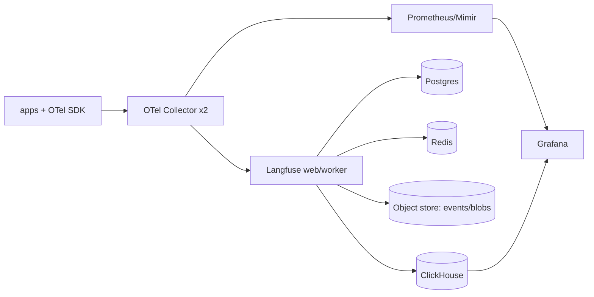

# Open-source approach

!!! tip "Hands-on"
    The [use cases](../use-cases/index.md) implement archetype **B** (OTel Collector + Prometheus/Tempo/Loki/Grafana) end to end, including dashboards, alert rules and failure simulators.

**Goal:** maximum control, transparent cost, and no per-event vendor pricing — in exchange for operating the platform.

## Archetypes

| Archetype | Components | Notes |
|---|---|---|
| **A. LLM-native OSS platform** | Langfuse, Arize Phoenix, Opik, Laminar, MLflow Tracing | Fastest to a useful UI: traces, sessions, prompts, datasets, evals |
| **B. Generic OSS observability + GenAI** | OTel Collector + Grafana stack (Tempo/Loki/Mimir) or SigNoz/Uptrace/OpenObserve, plus OpenLLMetry/OpenLIT | One stack for everything; LLM UX is thinner |
| **C. Warehouse-centric** | OTel → ClickHouse (or Iceberg lake) + Superset/Grafana | Best for long-range trends, cost, and ad-hoc SQL |
| **D. Gateway-centric** | LiteLLM / TensorZero / Envoy AI Gateway with built-in logging/metrics | Great for cost and routing; add A/B for quality |

Most mature teams combine **A + C** (or **B + C**).

## Licensing caveats (verify before adopting)

OSS is not one license. As examples as of mid-2026 — *verify current terms*:

| Project | License (as understood) | Watch-outs |
|---|---|---|
| Langfuse | MIT core; some enterprise features (e.g. SSO enforcement, RBAC, audit logs) are commercial | Acquired by ClickHouse (announced Jan 2026); core stated to remain open source |
| Arize Phoenix | Elastic License 2.0 | Source-available, not OSI open source; restrictions on offering as a managed service |
| Opik (Comet) | Apache-2.0 | Commercial hosted option |
| OpenLIT, Laminar, Lunary, OpenLLMetry | Apache-2.0 (verify per repo) | Smaller teams; check maintenance cadence |
| Helicone | Apache-2.0 | Reported to have moved into maintenance mode after joining Mintlify (Mar 2026) — assess viability |
| MLflow | Apache-2.0 | Strongest inside Databricks |
| Grafana stack | AGPLv3 (Grafana, Loki, Tempo, Mimir) | AGPL obligations if you modify and expose |
| ClickHouse, Prometheus, OTel | Apache-2.0 | — |

## Operating model

Plan for: HA deployment, upgrades, backups, scaling ClickHouse/Kafka/Redis dependencies, SSO/RBAC, retention jobs, and on-call. Rule of thumb: **0.5–1.5 FTE** of platform effort for a production-grade multi-team deployment.

### Minimal production topology (Langfuse-style, Kubernetes)

## Strengths and costs

| Strengths | Costs |
|---|---|
| Data stays in your VPC; predictable infra-only cost | You run it: upgrades, scaling, security patches |
| No per-trace pricing cliffs; customizable | Enterprise features (SSO, RBAC, audit) may be paid or DIY |
| Exit costs low; direct SQL on raw data | UX and integrations may lag top SaaS vendors |

## When to choose
Regulated/sovereign data, high volume where SaaS per-event pricing hurts, strong platform team, or desire to build a durable internal AI platform.
