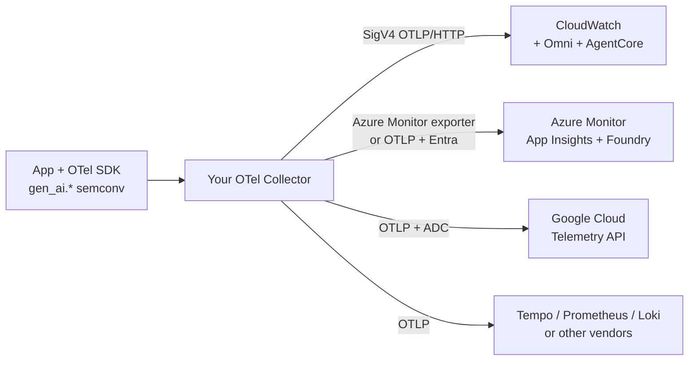

# Cloud-native AI observability: Azure, AWS and GCP

Each hyperscaler now ships an observability stack for generative AI and agents, and **all three have converged on OpenTelemetry (OTLP)** as the way in. This section covers what each offers, how its OpenTelemetry support really works, the new **Amazon CloudWatch Omni**, and an [enterprise implementation guide](implementation-guide.md).

*Snapshot: October 2026. Cloud features move monthly and several are labelled preview in one place and GA in another; every status below says where it came from. **Verify against the linked vendor docs before committing.***

| Page | Read it for |
|---|---|
| [AWS](aws.md) | CloudWatch generative AI observability, AgentCore Observability, native OTLP endpoints (traces/logs/metrics), ADOT, limits |
| [CloudWatch Omni](omni.md) | The new AI-first, team-and-application-centric experience: Spaces, investigations, agent tracing/evaluation, IDE extension |
| [Azure](azure.md) | Microsoft Foundry observability, Application Insights, Azure Monitor OTLP ingestion paths, Microsoft OpenTelemetry distro, APIM AI gateway |
| [GCP](gcp.md) | Cloud Trace / Monitoring / Logging via the Telemetry (OTLP) API, Vertex AI and Agent Runtime, Google-built Collector, GKE managed OTel |
| [Enterprise implementation guide](implementation-guide.md) | Landing zone, identity, network, residency, Collector tier, sampling, cost, governance, rollout, per-cloud checklists, multi-cloud |

## At a glance

| | **AWS** | **Azure** | **GCP** |
|---|---|---|---|
| **AI/agent platform** | Amazon Bedrock, Bedrock AgentCore | Microsoft Foundry (agents, models) | Vertex AI, Agent Runtime (formerly Agent Engine) |
| **AI-aware observability** | CloudWatch generative AI observability; **CloudWatch Omni** (GA Sep 2026) | Foundry Observability (Traces, evaluations, monitoring) on Application Insights | Cloud Trace + Cloud Monitoring + Cloud Logging, Vertex AI evaluation |
| **OTLP ingestion** | Native HTTP endpoints for **traces, logs, metrics** (SigV4 or bearer token for logs/metrics); no gRPC | Native OTLP paths: Collector (Entra auth), Azure Monitor Agent, AKS onboarding; plus Microsoft OpenTelemetry distro | Telemetry API `telemetry.googleapis.com`: traces GA, metrics GA (Aug 2026), logs rolling out |
| **GenAI semantic conventions** | ADOT / Strands emit `gen_ai.*` spans; OpenInference also supported | Distro emits latest `gen_ai.*` conventions (opt-in env vars); OpenInference supported | OTel GenAI instrumentation (e.g. Vertex AI, ADK, LangGraph samples) |
| **Gateway / metering** | Bedrock invocation logging, inference profiles with cost tags | API Management AI gateway (token metrics, limits) | Apigee / Cloud API gateways, Vertex AI usage metrics, Model Armor |
| **Safety** | Bedrock Guardrails | Azure AI Content Safety, Foundry guardrails | Model Armor |
| **Long-range analytics** | CloudWatch Logs Insights/PromQL, S3 + Athena | Log Analytics (KQL), export to ADLS/Fabric | Log sinks to BigQuery, Looker |
| **Agent trace UI** | CloudWatch GenAI Observability, **Omni Trace Explorer** | Foundry Observability > Traces | Cloud Trace Explorer |
| **Multi-cloud intake** | OTLP from anywhere (ADOT outside AWS); **Omni connectors** | Collector with Entra auth works anywhere | Collector / OTLP from anywhere |

## OpenTelemetry support, honestly

What "supports OpenTelemetry" means in practice:

1. **Ingestion:** can you send OTLP directly? AWS and Google expose first-party OTLP endpoints; Azure offers OTLP via an agent/Collector/AKS path with its own onboarding resources (and the Azure Monitor exporter remains the long-standing route).
2. **Semantic conventions:** the OTel GenAI conventions are still in **Development**, so each cloud's UI reads a specific version of the attributes. Pin your instrumentation version and test that your spans light up the cloud's AI views.
3. **Protocol constraints:** AWS endpoints are **HTTP only** (no gRPC) with request/size/series limits; Google's Telemetry API has its own quotas; Azure needs its onboarding resources (Application Insights, data collection configuration).
4. **Identity:** SigV4 (AWS), Microsoft Entra ID (Azure), Google ADC/IAM (GCP). Your Collector must be able to authenticate; this is the main integration chore.
5. **What is not portable:** the AI-aware UIs (Omni, Foundry, Vertex) depend on attributes and resource naming conventions specific to each platform even when the transport is OTLP.

!!! tip "The portable pattern"
    **Instrument once with OpenTelemetry → send to a Collector you control → fan out.** Each cloud's native backend becomes one exporter. You keep redaction, sampling and routing in your config, and you can add or swap backends (including the [OSS stack](../use-cases/index.md)) without touching applications.

## Choosing between native stacks

| Situation | Lean towards |
|---|---|
| One cloud, workloads on its AI platform | That cloud's native stack + Collector for portability |
| Agents on AWS (Bedrock AgentCore, Strands, LangGraph, CrewAI) wanting evaluation and AI-assisted troubleshooting | CloudWatch GenAI observability / **Omni** |
| Microsoft ecosystem (Agent Framework, Semantic Kernel, Copilot, Entra) | Foundry Observability + Application Insights |
| Gemini/Vertex AI, BigQuery-centred analytics | Cloud Trace/Monitoring + BigQuery |
| Several clouds | Collector tier + a neutral analysis plane (Grafana stack, warehouse) and use each native UI for its own workloads; Omni can ingest other clouds via connectors |
| Strict evaluation/prompt-management workflows not covered natively | Add an LLM-native tool (Langfuse, Phoenix, Braintrust…) behind the same Collector |

See also [Cloud-specific build-vs-buy](../build-vs-buy/cloud-specific.md) and the [build vs buy framework](../build-vs-buy/decision-framework.md).
