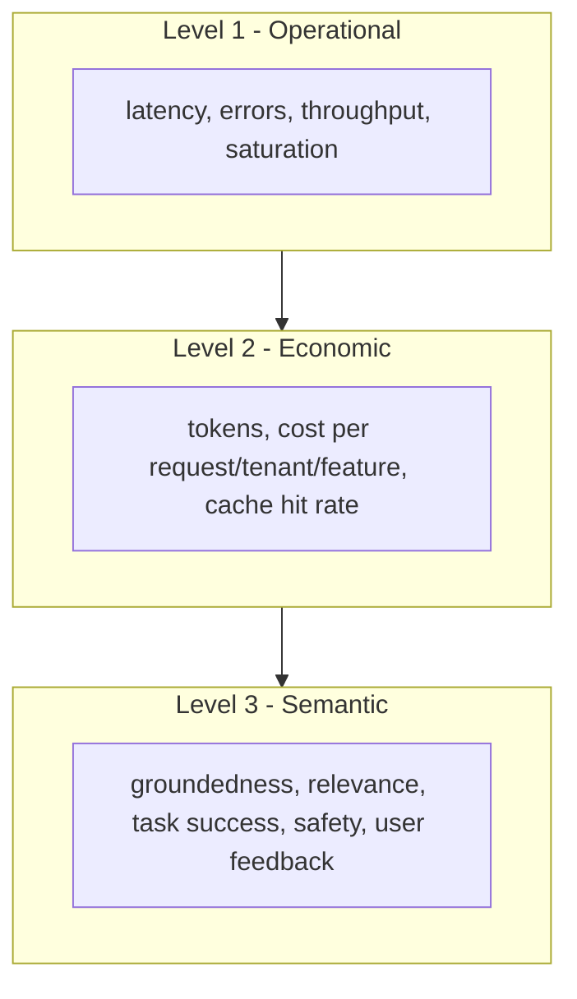

# How AI observability differs from traditional APM

| Dimension | Traditional services | AI applications |
|---|---|---|
| Behavior | Deterministic; same input → same output | Non-deterministic; temperature, retrieval and model drift |
| Correctness signal | Status code, assertions | Needs **evaluation** (heuristic, model-as-judge, human) |
| Latency shape | Roughly normal; p99 meaningful | Long-tailed, depends on output length; need **TTFT** and **tokens/sec** |
| Cost model | Mostly infra (CPU/memory), flat-ish | **Per-token and per-call** variable cost on every request |
| Payloads | Small, structured, mostly safe to log | Large free-text prompts/responses; contain PII and secrets |
| Dependencies | Services, DBs | Model providers, vector DBs, rerankers, tools, MCP servers, other agents |
| Failure | Errors, timeouts | Plausible-but-wrong, refusals, loops, unsafe output |
| Change surface | Code deploys | Code + **prompt + model version + index + embedding + config + tools** |
| Debugging unit | Trace of service calls | Trace + **retrieved context + prompt + tool I/O + judge scores** |
| Retention need | Days–weeks of detail | Weeks of detail, **months–years of aggregates** (trend, regression, audit) |

## What stays the same

Do **not** build a separate silo. AI telemetry should ride on your existing observability stack where possible: same trace context propagation (W3C `traceparent`), same SLO and on-call practice, same identity and access model. The AI-specific layer adds **semantics** (prompts, tokens, evals) not a parallel universe.

!!! info "Rule of thumb"
    Reuse APM for infrastructure, golden signals and distributed tracing. Add an **LLM-aware layer** for content, evaluation, cost attribution and prompt/dataset management. Whether that layer is one product or two is the build-vs-buy question.

## Three levels of signal

Teams typically get Level 1 for free from APM, build Level 2 quickly from token usage, and struggle with Level 3 — which is where most of the value (and most of the vendor differentiation) lives.
