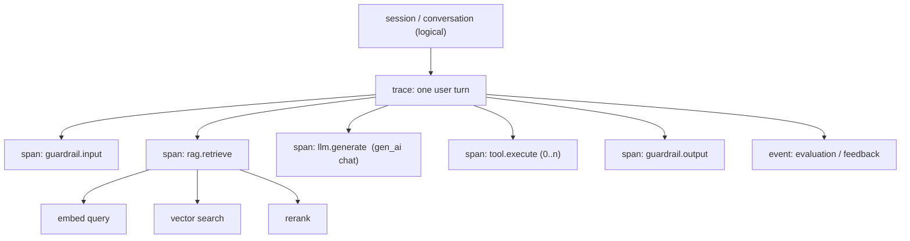

# Telemetry model & OpenTelemetry

## Signals

| Signal | Use for AI | Notes |
|---|---|---|
| **Traces / spans** | Request lifecycle: retrieval → rerank → prompt → LLM → tools → guardrails | Primary debugging unit; one trace per user request/turn |
| **Metrics** | Latency histograms, token counters, cost, error rate, eval score distributions | Cheap, long retention; drive SLOs and trends |
| **Logs / events** | Prompt/response content, guardrail verdicts, feedback | Sensitive; gate and redact; sample |
| **Evaluations** | Scores attached to a trace/span (online) or to a dataset run (offline) | Store as span events/attributes **and** in an analytical store |
| **Datasets / experiments** | Golden sets, regression sets, A/B variants | Link production traces → datasets for the flywheel |

## Span hierarchy (recommended)



## OpenTelemetry GenAI semantic conventions

OpenTelemetry defines `gen_ai.*` attributes, spans and metrics for model calls, agents and tool execution. **Status: Development (not stable) as of mid-2026** — attribute and metric names may change between versions. Pin the semconv version you target and use `OTEL_SEMCONV_STABILITY_OPT_IN` as the conventions describe.

Commonly used attributes (verify against the version you target):

| Attribute | Meaning |
|---|---|
| `gen_ai.operation.name` | `chat`, `embeddings`, `execute_tool`, `invoke_agent`, … |
| `gen_ai.provider.name` (older: `gen_ai.system`) | Provider, e.g. `openai`, `anthropic`, `aws.bedrock` |
| `gen_ai.request.model` / `gen_ai.response.model` | Requested vs actually served model |
| `gen_ai.request.temperature`, `.max_tokens`, `.top_p` | Request parameters |
| `gen_ai.usage.input_tokens` / `gen_ai.usage.output_tokens` | Token usage |
| `gen_ai.response.finish_reasons` | Why generation stopped |
| `gen_ai.conversation.id` | Conversation/session correlation |
| `gen_ai.tool.name`, `gen_ai.tool.call.id` | Tool execution |
| `gen_ai.agent.name`, `gen_ai.agent.id` | Agent identity |

Metrics: client operation duration, client token usage (histograms), plus server-side time-to-first-token / time-per-output-token for model servers.

**Message content** (prompts/completions) is opt-in by design — treat it as sensitive and capture it through a controlled path (see [Security & privacy](../architecture/security-privacy.md)).

## Interoperating conventions

| Convention | Origin | When to use |
|---|---|---|
| **OTel GenAI semconv** | CNCF OpenTelemetry | Default for vendor-neutral portability |
| **OpenInference** | Arize | Rich span kinds (RETRIEVER, RERANKER, TOOL, AGENT…); Phoenix and others consume it |
| **OpenLLMetry** (Traceloop) | Community | Auto-instrumentation libraries for many providers/frameworks |
| **OpenLIT** | Community | Auto-instrumentation plus GPU/vector DB monitoring |
| Vendor SDKs | Langfuse, LangSmith, Braintrust, Weave… | Fastest start, richer UI; check OTel ingest/export before committing |

!!! tip "Portability principle"
    Instrument with OpenTelemetry (or an OTel-compatible library), add your own `app.*` attributes for business context, and **send through an OpenTelemetry Collector you control**. Backends then become swappable without re-instrumenting.

## Custom attribute namespace

Define a small, stable `app.*` / `rag.*` namespace so analysis does not depend on any vendor:

```text
app.tenant.id          app.feature           app.environment
app.release.id         app.prompt.id         app.prompt.version
rag.index.id           rag.index.version     rag.embedding.model
rag.retrieval.top_k    rag.retrieval.count   rag.rerank.model
rag.context.tokens     rag.context.doc_ids   rag.cache.hit
eval.<name>.score      eval.<name>.label     feedback.rating
cost.usd.total         cost.usd.llm          cost.usd.retrieval
```
