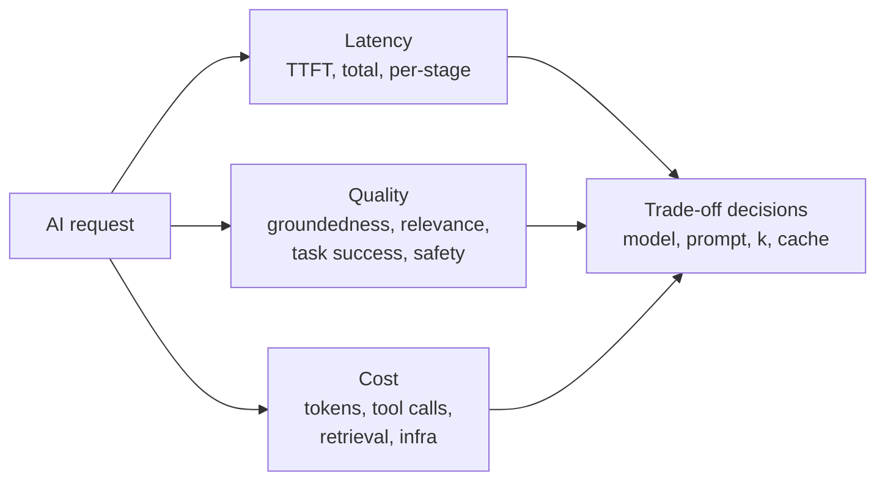

# Why AI observability

!!! note "Two different things"
    This handbook is mainly about **observability *for* AI** (observing AI applications). Using AI to *do* observability is a separate topic: see [AI for observability vs observability for AI](../ai-and-observability/index.md).

Traditional monitoring answers *"is the service up and fast?"*. For AI applications that is necessary but not sufficient: a RAG app can return HTTP 200 in 800 ms with a **confidently wrong, ungrounded or unsafe answer**, at **ten times the expected cost**.

## The three pillars for AI: latency, quality, cost

These three are **coupled**. A cheaper model lowers cost but may reduce quality; a larger `top_k` may raise quality but increases latency and cost. Observability exists to make those trade-offs *measurable and reversible*.

## Failure modes that only AI observability catches

| Failure | Looks like in APM | What you need |
|---|---|---|
| Silent quality regression after a prompt/model/index change | Nothing | Online evals + release annotations |
| Retrieval drift (stale/poisoned index, embedding model change) | Nothing | Retrieval relevance, context precision/recall, index freshness |
| Cost explosion (agent loop, long context, retry storm) | Slightly higher latency | Token/cost per trace, per tenant, per feature |
| Provider-side model update ("silent" version drift) | Nothing | Pin model versions; track response fingerprint & eval baselines |
| Hallucination / ungrounded answers | 200 OK | Groundedness / citation-support score |
| Prompt injection, data leakage, jailbreak | Nothing | Guardrail verdicts, PII detections, red-team canaries |
| Agent loops, wrong tool selection | Long latency | Step counts, tool-call success, trajectory evals |
| Rate limiting / quota exhaustion | 429s | Per-model quota headroom, fallback rates |

## Outcomes you should be able to claim

1. **Detect** a latency, quality or cost regression within minutes (alerts) or days (trend/drift).
2. **Explain** any single bad answer end-to-end (trace → retrieved chunks → prompt → model → answer → evaluator score).
3. **Attribute** cost to tenant, feature, model, prompt version and team (FinOps/showback).
4. **Prove** to risk/compliance what the system did (audit, lineage) without over-collecting personal data.
5. **Trend** all of the above over months, annotated with every change (model, prompt, index, config, code).

## Who uses the data

| Persona | Questions |
|---|---|
| AI/ML engineer | Which stage is slow? Which retrieval config scores best? Did my prompt change help? |
| Platform/SRE | Are we within SLO? Is a provider degrading? Which dependency to fail over? |
| Product owner | Are users getting task success? Which topics fail? Thumbs-down rate by cohort? |
| FinOps | Cost per answer, per tenant, per feature; budget burn rate and forecast |
| Security/Risk/Compliance | Policy violations, PII exposure, audit trail, model inventory |
