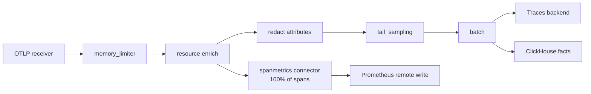
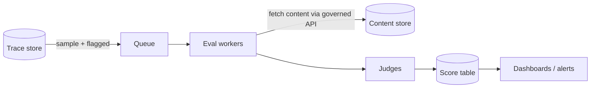

# Collector & pipeline

The OpenTelemetry Collector is the control point for **redaction, sampling, enrichment and routing**. Keep its config in Git; roll out with canaries.

Reference config: [`examples/otel-collector.yaml`](https://github.com/akashtalole/ai-observability/blob/main/examples/otel-collector.yaml).

## Pipeline order matters

1. **Metrics before sampling** so rates, percentiles and costs are unbiased.
2. **Redact before export** (and before tail-sampling buffers if memory dumps are a concern).
3. **Tail-sample** on error, latency, eval flags, tenant tier; probabilistic for the rest.
4. **Batch** last; set memory limits; use persistent queues for durability where needed.

## Deployment

| Pattern | Use |
|---|---|
| Agent (sidecar/daemonset) | Local buffering, resource detection |
| Gateway (central deployment, ≥2 replicas) | Tail sampling needs all spans of a trace on one instance → use load-balancing exporter keyed by `trace_id` |
| Two-tier (agent → gateway) | Recommended for scale |

## Operating the pipeline

* Monitor the Collector itself: `otelcol_receiver_refused_spans`, `otelcol_exporter_send_failed_spans`, queue size, memory.
* Alert on telemetry loss (drop rate) separately from product SLOs.
* Version-control and test configs (`otelcol validate`), including redaction fixtures.
* Keep per-tenant routing rules for data-residency (EU tenants → EU backend).

## Evaluation worker pipeline

* Idempotent workers keyed by `(trace_id, metric, eval_version)`.
* Rate-limit judge calls; track `eval_queue_age` and `eval_cost_usd`.
* Never fail the user request because evaluation failed.
