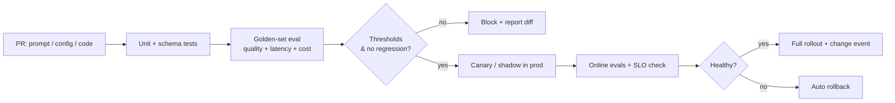

# Evals in CI/CD

Treat prompts, retrieval config, indexes and models like code: **no change ships without a regression run**.

## Pipeline



## Gate design

| Gate | Example threshold |
|---|---|
| Groundedness mean | ≥ baseline − 0.02 and ≥ 0.85 absolute |
| Answer relevance | ≥ baseline − 0.02 |
| Safety suite | 0 critical failures; ≤ 0.5 % minor |
| p95 latency (staging replay) | ≤ baseline × 1.1 |
| Cost per request | ≤ baseline × 1.15 (or explicit approval) |
| Key-slice protection | No intent cluster drops > 0.05 |

Use paired comparisons (same questions) with bootstrap confidence intervals; fail only on statistically meaningful regressions to avoid flaky gates.

## Example GitHub Actions job

```yaml
name: rag-eval
on:
  pull_request:
    paths: ["prompts/**", "rag/**", "evals/**"]
jobs:
  eval:
    runs-on: ubuntu-latest
    steps:
      - uses: actions/checkout@v4
      - uses: actions/setup-python@v5
        with: {python-version: "3.12"}
      - run: pip install -r evals/requirements.txt
      - name: Run golden-set evals
        run: python evals/run.py --dataset evals/golden.jsonl --out eval-report.json
        env:
          JUDGE_API_KEY: ${{ secrets.JUDGE_API_KEY }}
      - name: Compare with baseline and gate
        run: python evals/gate.py --report eval-report.json --baseline evals/baseline.json
      - uses: actions/upload-artifact@v4
        with: {name: eval-report, path: eval-report.json}
```

## Golden set hygiene

* 200–1000 items to start; stratified by intent, difficulty, tenant tier; include **unanswerable**, **adversarial** and **multi-hop** items.
* Source from production (redacted) and SMEs; every thumbs-down triage can promote an item.
* Version it; track label provenance; freeze a "holdout" never used for tuning.
* Re-calibrate judges when the rubric or judge model changes.

## Post-deploy verification
Automatically compare the first N hours of production metrics/scores with the pre-change baseline and post a **change-impact report** (use query #8 in [rag_queries.sql](https://github.com/akashtalole/ai-observability/blob/main/examples/sql/rag_queries.sql)).
