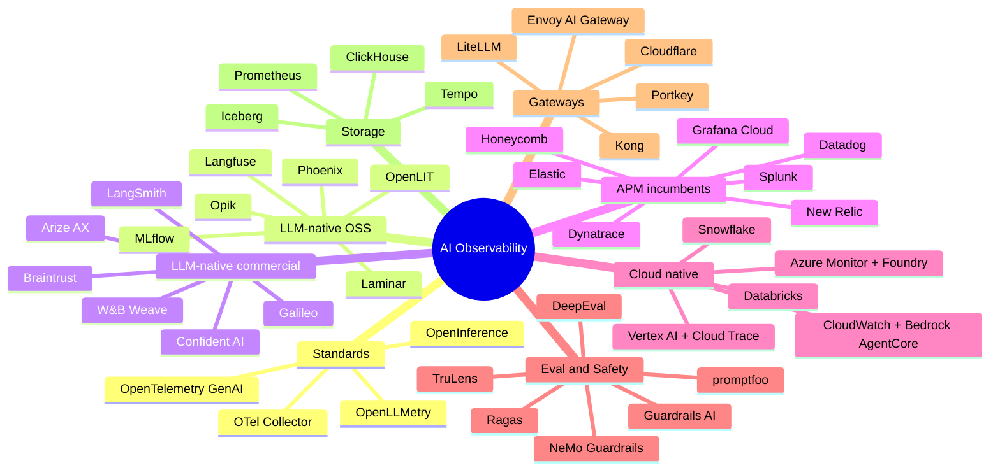

# Landscape overview

*Snapshot: October 2026. Vendor facts change quickly — verify before purchase. The complete list (68 entries) is in the [tool catalog](catalog.md); an interactive filterable version is in the [HTML artifacts](../artifacts/index.md).*

## Eight categories

| # | Category | Job | Pick when |
|---|---|---|---|
| 1 | **Standards & instrumentation** | Portable telemetry | Always — start here |
| 2 | **LLM-native OSS platforms** | Traces, prompts, datasets, evals you can self-host | Data control, cost predictability |
| 3 | **LLM-native commercial platforms** | Same, managed, with enterprise collaboration | Speed, small platform team |
| 4 | **APM incumbents** | Unify AI with infra/app signals | Already standardized on the APM |
| 5 | **Cloud-native** | Integrated in the provider's AI platform | Single-cloud estate |
| 6 | **Evaluation & testing** | Quality scoring, regression, red-teaming | Needed in every option |
| 7 | **Guardrails & safety** | Runtime policy enforcement and detection | Regulated or user-facing apps |
| 8 | **Gateways** | Metering, routing, quotas, caching | Multi-team/provider cost control |
| 9 | **Storage & dashboards** | Long-range trends and analytics | Months of history, cost reporting |

## Market dynamics to plan around

* **Consolidation.** Observability platforms are being acquired by data, APM and AI-infrastructure companies (e.g. Langfuse by ClickHouse, announced January 2026; Helicone reported to have joined Mintlify in March 2026 and moved to maintenance mode). Insist on OTel ingest/export and data-export rights.
* **OpenTelemetry convergence.** Nearly every vendor now ingests OTLP and GenAI semconv, shifting differentiation from *collection* to *evaluation, analysis and workflow*.
* **APMs moving up-stack.** Datadog, Dynatrace, New Relic, Grafana, Splunk, Elastic ship LLM/agent modules; LLM-native vendors respond with broader infra and security features.
* **Agent observability** (multi-step trajectories, tool calls, MCP) is the current frontier; assess trace UX for long, branching runs.
* **Evaluation cost** is a first-class budget line; look for tiered/cheap evaluators and sampling controls.
* **Licensing drift.** "Open source" ranges from MIT/Apache to source-available (Elastic License 2.0, FSL). Read the license for your intended use.

## Evaluation criteria for any tool

1. OTLP ingest **and** data export; GenAI semconv support level.
2. Trace fidelity for RAG (retriever/reranker spans, chunk-level scores) and agents (nested steps, tool I/O, loops).
3. Evaluation: built-in metrics, custom judges, online scoring on production traces, dataset/experiment workflow, CI integration.
4. Cost: token → $ mapping with custom price tables, per-tenant/feature attribution, budgets.
5. Time-range support: retention, rollups, SQL/API access for months-long trends.
6. Security: SSO/SCIM, RBAC, audit logs, PII redaction, regions, self-host/BYOC.
7. Scale and pricing model (per span/event/seat/GB) at 3× volume.
8. Alerting and integrations (PagerDuty, Slack, Jira, CI).
