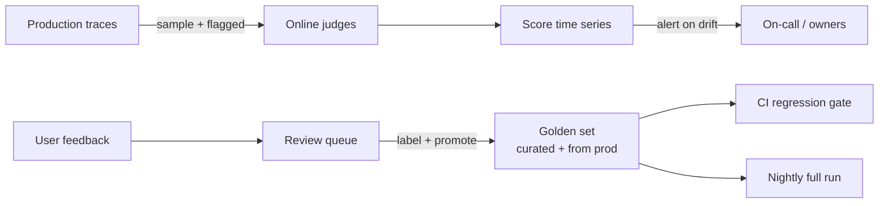

# Evaluation & quality measurement

!!! tip "Deeper guidance"
    Online vs offline scoring, sampling, judges, gates and operating cost are covered in the [Scoring section](../scoring/index.md).

Quality is the hardest of the three pillars because correctness is not directly observable. Build a **layered** evaluation strategy.

## Evaluation layers

| Layer | Examples | Cost | Coverage | Use |
|---|---|---|---|---|
| **1. Deterministic checks** | schema validity, citation present, language, length, regex PII, banned phrases, link validity | ~free | 100 % | gating, alerts |
| **2. Heuristic / embedding** | answer-to-context similarity, retrieval score thresholds, duplicate detection | low | 100 % | cheap proxy signals |
| **3. LLM-as-judge (small model)** | groundedness, relevance, tone, refusal appropriateness | medium | 2–10 % sample + flagged | online trend |
| **4. LLM-as-judge (strong model) / panel** | complex reasoning, safety nuance | high | golden sets, escalations | releases, audits |
| **5. Human review** | expert labels, annotation queues | highest | small, targeted | calibrate judges, ground truth |
| **6. User signals** | thumbs, edits, escalation, abandonment | free | sparse/biased | trend, triage |

## RAG metrics (the "triad" plus)

| Question | Metric | Needs reference? |
|---|---|---|
| Did we retrieve the right stuff? | Context relevance / precision@k / recall@k / MRR / nDCG | recall needs labels |
| Is the answer supported by the retrieved stuff? | **Groundedness / faithfulness** | no |
| Does the answer address the question? | Answer relevance | no |
| Is it correct? | Answer correctness vs reference | yes |
| Did it cite properly? | Citation precision / recall | no/yes |
| Should it have abstained? | Abstention accuracy on unanswerable set | yes |

## Agent metrics

Task success, tool-selection accuracy, argument validity, step efficiency (steps vs optimal), loop rate, plan adherence, recovery from tool errors, unsafe action rate, cost per completed task.

## Making judges trustworthy

1. **Calibrate** judges against 100–300 human-labelled examples; report agreement (Cohen's κ / Spearman).
2. **Pin judge model + prompt version**; record in `eval_version`. Changing the judge breaks trend continuity — re-score a baseline slice when you do.
3. **Mitigate bias**: position, verbosity, self-preference (use a different model family from the generator where possible).
4. Use **rubrics with decomposed claims** (extract claims → verify each against context) rather than a single 1–10 score.
5. Track **judge cost and latency** as first-class metrics.
6. Run **judge drift checks**: re-score a fixed anchor set weekly.

## Offline vs online

* **Offline** answers "is this change safe to ship?" (controlled, comparable, reference-based).
* **Online** answers "is production healthy right now / this quarter?" (real distribution, reference-free).

## Sampling for online evals

Stratify by `app × tenant tier × intent`; add 100 % of: thumbs-down, escalations, guardrail hits, low retrieval score, slow or costly outliers; plus a small always-on random slice for unbiased baselines.

## Keeping quality trends comparable over months

* Version everything: `eval_version`, judge prompt, rubric, model.
* Keep an **anchor set** re-scored on every judge change.
* Report **confidence intervals**; show sample size on charts.
* Segment by intent/topic — aggregate means hide regressions in important slices.
