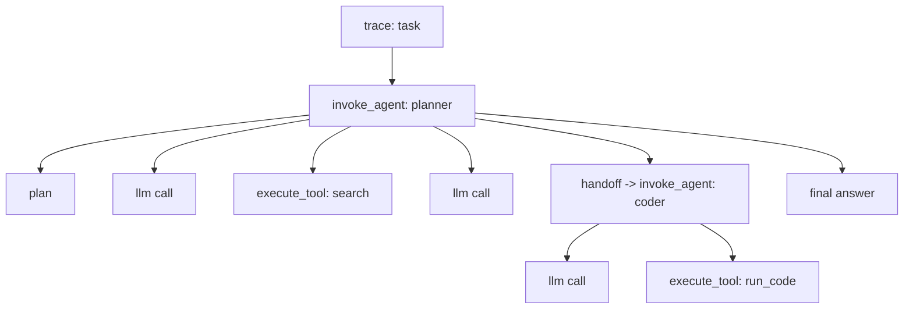

# Monitoring agents & multi-agent systems

!!! tip "Run it"
    A runnable multi-agent implementation (supervisor + sub-agents, tools, loops, budgets, approvals) with dashboards and alerts is in [Use case: Multi-agent](../use-cases/multi-agent.md).

Agents plan, call tools, observe results and iterate. Cost, latency and failure are **path-dependent**, so you must observe *trajectories*, not just single calls.

## Trace model

Use `invoke_agent`, `execute_tool`, `chat` span kinds (OTel GenAI / OpenInference). Tag every span with `agent.name`, `step_index`, `parent_agent`.

## Metrics

| Category | Metrics |
|---|---|
| **Outcome** | Task success rate, partial success, abandonment, human-takeover rate, time to completion |
| **Efficiency** | Steps per task (p50/p95), LLM calls per task, tokens per task, cost per **successful** task, redundant tool-call rate |
| **Tool use** | Tool-call success/error rate, wrong-tool rate, argument validity, tool latency, retries, idempotency violations |
| **Planning** | Plan revisions, plan-vs-execution divergence, goal drift |
| **Safety** | Unauthorized or denied actions, write/destructive-action rate, human-approval requests/overrides, prompt-injection via tool outputs |
| **Reliability** | Loop/stall detection, max-step terminations, timeout rate, context-window overflows, memory errors |
| **Multi-agent** | Handoff count, handoff failures, agent utilization, deadlock/ping-pong detection, message size |
| **Memory** | Memory read hit rate, stale memory use, memory write volume |

## Guardrails for runaway behavior (and their telemetry)

| Control | Telemetry |
|---|---|
| Max steps / max tokens / max wall-clock per task | `terminated_reason`, count by reason |
| Per-task budget (USD) | cost at termination, budget-hit rate |
| Loop detector (repeated identical tool call/args) | `loops_detected` |
| Tool allow-lists and human approval for destructive actions | approvals requested/granted/denied |
| Sandboxed code execution | exec time, exit codes, resource limits hit |

## Evaluating agents

* **Outcome evals:** did the end state satisfy the goal (programmatic checks where possible).
* **Trajectory evals:** tool choice, order, efficiency vs reference trajectory.
* **Simulation:** scripted or LLM-simulated users/environments to test before release.
* **Regression suites:** replay recorded tool responses for deterministic comparison.

## Dashboards
Task funnel (started → completed → verified), step-count distribution, cost-per-task by agent version, tool error heatmap, top failing trajectories (click-through to trace), approval queue.
