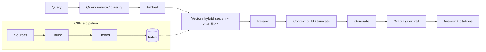

# Monitoring RAG applications

!!! tip "Run it"
    A runnable implementation on OpenTelemetry, Prometheus, Grafana, Loki and Tempo, with dashboards, alerts and fault scenarios, is in [Use case: RAG](../use-cases/rag.md).

Full walkthrough with dashboards and queries: [RAG observability playbook](../rag/rag-observability-playbook.md). This page is the monitoring checklist.

## Pipeline and where to measure

| Stage | Latency | Quality | Cost | Health |
|---|---|---|---|---|
| Query rewrite | ms, tokens | rewrite faithfulness | tokens | failure rate |
| Embed | ms | — | embedding tokens | provider errors |
| Search | ms | top-k scores, recall@k (offline) | DB cost | timeouts, empty rate |
| ACL filter | ms | filtered count (security) | — | policy errors |
| Rerank | ms | relevance lift | rerank calls | — |
| Context build | ms | chunk dup rate, context tokens | — | truncation rate |
| Generate | TTFT, total | groundedness, relevance, citation accuracy | tokens | finish_reason=length |
| Guardrail | ms | block/redact rate, false positives | per-call | — |
| Ingestion | lag | parse/chunk quality | embed cost | failed docs, staleness |

## RAG-specific failure modes → signals

| Symptom | Likely cause | Signal |
|---|---|---|
| Confident wrong answers | Retrieval missed / irrelevant chunks | low context relevance, low top-1 score, low groundedness |
| "I don't know" too often | Over-strict threshold, coverage gap | empty-retrieval ↑, abstention ↑, thumbs-down on unanswered |
| Outdated answers | Index staleness, failed ingestion | doc age p95 ↑, ingestion lag ↑ |
| Latency up | Larger k/context, slower DB, rerank model | stage-level latency, context tokens |
| Cost up | Longer contexts, retries, model upgrade | cost/request by version, context tokens |
| Sudden quality drop after reindex | New chunking/embedding | index_version annotation + score shift |
| Cross-tenant leak | ACL filter bug | filtered-count anomalies, canary doc tests |
| Citation errors | Prompt/format drift | citation accuracy |

## What to alert on
Empty retrieval rate, top-1 score median, groundedness rolling mean, TTFT p95, cost/request p95, index freshness, ingestion failures, ACL canary failures.

## Golden practices
* Version the **index** (`index_version`) and **embedding model** on every trace.
* Log `retrieved_doc_ids` + scores always; chunk text only on sampled/flagged traces.
* Build the golden set from real queries; include unanswerable and adversarial ones.
* Re-run golden set on every index rebuild, chunking change, embedding change and model/prompt change.
