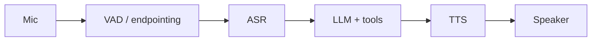

# Voice, multimodal & batch/pipeline workloads

## Voice agents

| Metric | Notes |
|---|---|
| **Turn latency** (end of user speech → first audio out) | Target typically < ~1 s for natural feel; measure p50/p95 per stage |
| ASR word error rate (sampled vs human transcript), confidence | Per accent/language/channel |
| Endpointing errors: premature cut-off, late response | Tune VAD |
| Barge-in/interruption handling success | UX critical |
| TTS latency, MOS/naturalness proxy, audio glitches | |
| Dead-air and talk-over rates | |
| Call outcome: containment, transfer, task success | |
| Cost per minute (ASR + LLM + TTS + telephony) | |

Privacy: audio is biometric-adjacent; store transcripts redacted, audio only with consent and short retention.

## Multimodal (vision / document AI)

* Input metrics: image/page count, resolution, file type, OCR confidence.
* Token cost of images/pages (often dominant) — track per modality.
* Quality: field-level extraction accuracy, layout errors, table fidelity, caption faithfulness.
* Failure: unreadable/blank pages, unsupported formats, oversized inputs.

## Batch & pipeline workloads (classification, extraction, summarization, enrichment)

| Metric | Notes |
|---|---|
| Throughput (items/min), job duration, queue depth, SLA attainment | Capacity |
| Per-item cost and cost per 1k items | Budget |
| Accuracy vs labeled sample (precision/recall/F1 per class/field) | Run a continuous labeled "canary" slice |
| Output validity (schema parse rate), retry/repair rate | Prompt/model drift |
| Failure taxonomy, dead-letter queue size | Operability |
| Distribution drift of inputs and predicted labels | Silent degradation |
| Provider batch API utilization / discount capture | Cost |

Batch jobs need **per-run summaries** (one fact row per run: version set, volume, cost, accuracy sample, duration) in addition to per-item data.

## Fine-tuned / distilled model rollouts

Shadow → canary → full rollout with the same golden set and online evals; track delta vs baseline model on quality, latency and cost-per-task; keep rollback criteria in the change request.
