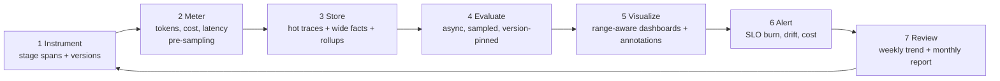

# RAG playbook: latency, quality & cost over any time range

**Goal:** full visibility into latency, quality and cost of the RAG app across any time range, catching issues early and tracking trends over months.

## The recipe in seven steps

### 1. Instrument every stage
Create spans for `rag.request` → `rag.retrieve` (embed, search, rerank) → `chat <model>` → `guardrail`. Attach `app.*`, `rag.*`, `gen_ai.*` attributes including **prompt, model, index and embedding versions**. Code: [`examples/rag-otel/instrument.py`](https://github.com/akashtalole/ai-observability/blob/main/examples/rag-otel/instrument.py), guide: [Instrumentation](../implementation/instrumentation.md).

### 2. Meter cost and latency from 100 % of traffic
Compute metrics (counters, histograms) **before** trace sampling. Compute cost at request time from a versioned price table you own: `cost = in_tokens × p_in + out_tokens × p_out (+ embed + rerank + retrieval infra)`.

### 3. Store for every time range
* **Hot (7–30 d):** traces for debugging.
* **Warm (13–24 mo):** wide per-request fact table ([schema](https://github.com/akashtalole/ai-observability/blob/main/examples/sql/clickhouse_schema.sql)).
* **Rollups:** hourly/daily with mergeable quantile states so a 12-month chart reads thousands, not billions, of rows.

### 4. Evaluate quality continuously
* Deterministic checks on 100 %; small-model judge on a stratified sample; strong judge on flagged traces; humans on calibration sets ([Evaluation](../metrics/evaluation.md)).
* Scores written back keyed by `trace_id` and stored with `eval_version`.

### 5. Visualize with time-range-aware dashboards
Panels that pick rollup granularity from the selected range, overlay change events and show sample sizes. Layout in [Dashboards & queries](dashboards-and-queries.md).

### 6. Alert early
* **Minutes:** error/TTFT burn-rate, cost spike, retrieval emptiness, agent/loop runaway.
* **Hours–days:** quality regression vs 28-day baseline, drift, index staleness.
* Every alert links to a trace sample, dashboard and runbook ([Runbooks](../operations/runbooks.md)).

### 7. Review trends on a cadence
* **Weekly:** SLO attainment, top regressions, cost anomalies, new failure clusters → backlog.
* **Monthly:** month-over-month cost per resolved query, p95 latency, quality by intent, model/prompt/index change log vs metrics, budget forecast.
* **Quarterly:** build-vs-buy re-check, evaluator calibration, retention/cost tuning.

## The three questions every dashboard must answer

| Pillar | Headline questions | Key panels |
|---|---|---|
| **Latency** | Are users waiting? Which stage? Did it change? | TTFT & total p50/p95/p99 trend; stacked stage latency; slow-trace table; latency vs context tokens |
| **Quality** | Are answers right and grounded? Which topics fail? | Groundedness/relevance trend with n; retrieval score distribution; low-score trace queue; thumbs-down rate by intent |
| **Cost** | What does an answer cost? Who/what drives it? | Cost/request trend; cost by tenant/feature/model/prompt; tokens in vs out; budget burn; cache savings |

## Trade-off analysis: use the three together

Plot **quality vs cost vs latency per configuration** (model × top_k × reranker × prompt) from golden-set runs and from online A/B slices. Pick the Pareto-efficient configuration; record the decision as a change event.

| Config | Groundedness | p95 latency | Cost / request |
|---|---|---|---|
| large model, k=8, rerank | 0.93 | 6.1 s | $0.011 |
| large model, k=5, rerank | 0.92 | 4.8 s | $0.008 |
| small model, k=5, rerank | 0.88 | 2.2 s | $0.001 |
| small model, k=5, no rerank | 0.83 | 1.7 s | $0.0008 |

*(Illustrative numbers — measure your own.)* Here "large, k=5, rerank" may be the best default, "small, k=5, rerank" the cost-optimized tier for low-risk intents (route by intent).

## Early-warning signals (leading indicators)

| Leading indicator | Predicts |
|---|---|
| Top-1 similarity median ↓, empty-retrieval ↑ | Quality drop (coverage/embedding issue) |
| Index freshness lag ↑ | Outdated answers |
| Context tokens ↑ | Latency and cost increase |
| Retry / fallback rate ↑ | Provider incident, cost and latency |
| Output length ↑ or `finish_reason=length` ↑ | Cost, truncated answers |
| Thumbs-down on specific intent cluster ↑ | Targeted regression |
| Judge-score variance ↑ | Prompt instability or judge drift |
| New query clusters with low retrieval score | Content gap |

## Reading trends correctly

1. Always compare **same-slice, same-evaluator-version** windows.
2. Use rolling baselines (28-day median ± MAD) to tell drift from seasonality (weekday/weekend, month-end).
3. Check **traffic mix** before blaming the system: Simpson's paradox is common when intent mix shifts.
4. Show sample size / confidence intervals on every quality chart.
5. Tie shifts to change events; if none exists, suspect **provider-side model changes** or data drift.
