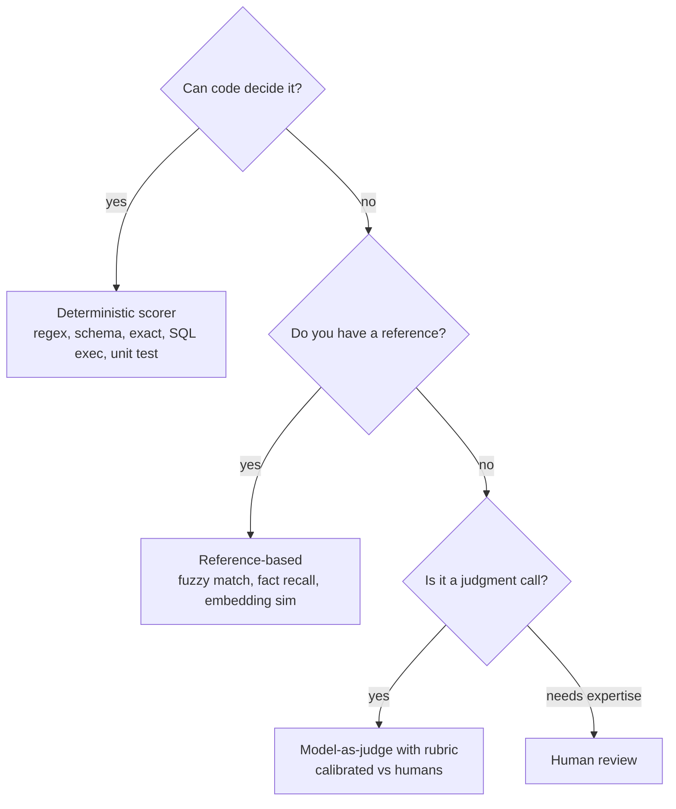

# Designing scorers

A scorer maps an input/output (and sometimes context, trace or reference) to a number in [0, 1] or a label. Scorer quality bounds everything built on it.

## Pick the cheapest valid scorer



Order of preference: **programmatic checks > reference-based > small-model judge > strong-model judge > human**, escalating only where the cheaper tier is not valid. Programmatic checks are exact, free, reproducible and not subject to judge bias.

## Model-as-judge: how to do it well

1. **Narrow, single-criterion rubrics.** One judge call per criterion (groundedness, relevance, tone). Multi-criterion scores blur and correlate.
2. **Decompose.** For groundedness: extract atomic claims from the answer, then verify each against the context; score = supported claims ÷ claims. More reliable than "rate 1-10".
3. **Categorical or binary outputs beat 1-10 scales.** Use labels with definitions (`supported / partially / unsupported`) and map to numbers; add short reasoning before the verdict.
4. **Give anchors.** Include 2-4 labeled examples per class in the prompt (few-shot), including borderline cases.
5. **Control randomness.** Temperature 0, fixed seed where available, pinned model version; for noisy criteria use 3 votes and take the majority or mean.
6. **Pairwise for comparisons.** "Which answer is better?" is more reliable than absolute scores; randomize order to cancel position bias.
7. **Use a different model family** from the generator where possible, to reduce self-preference.
8. **Constrain output** (JSON schema) and validate; treat malformed judge output as a scorer failure, not a low score.

### Rubric template

```text
Criterion: Groundedness
Definition: Every factual claim in the ANSWER is supported by the CONTEXT.
Steps: 1) list the claims, 2) for each claim, quote the supporting context or say "none",
       3) label each claim supported / unsupported.
Output JSON: {"claims":[{"text":"...","support":"supported|unsupported","evidence":"..."}],
              "label":"fully|partially|not_grounded"}
Mapping: fully=1.0, partially=0.5, not_grounded=0.0
Do not use outside knowledge. Ignore style and length.
```

## Calibrate and validate the judge

A judge is a measurement instrument. Validate it before trusting it, and again after any change.

| Step | What to do |
|---|---|
| **Label a calibration set** | 100-300 items, ≥ 2 human raters, written guidelines; measure inter-rater agreement first (the ceiling) |
| **Measure judge-human agreement** | Cohen's κ / Krippendorff's α for labels, Spearman for scores; report per class and per slice |
| **Check error structure** | False-positive vs false-negative rates; for safety scorers, recall on the positive class matters most |
| **Probe for bias** | Position (swap order), verbosity (pad answers), self-preference (same-family generator), format, sycophancy to the answer's confidence |
| **Test sensitivity** | Inject known defects (remove a fact, add a hallucination) and confirm the score drops |
| **Track drift** | Re-score a fixed anchor set weekly; alert when judge output on it changes |
| **Record cost and latency** | Judge tokens per score, p95 latency |

Rule of thumb: if judge-human agreement is not close to human-human agreement, fix the rubric before scaling the judge.

## Version everything

```yaml
scorer: groundedness
version: 3
judge_model: judge-small-2026-08     # pinned
prompt_hash: 9f1c2e
rubric: groundedness@v3
calibration: {set: calib-2026-09, kappa: 0.78, n: 240}
```

Write `scorer_version` on every score. When it changes: annotate dashboards, re-score the anchor set under old and new versions, and publish the offset so trends stay interpretable.

## Metric choice by what you measure

| Property | Scorer | Notes |
|---|---|---|
| Format / schema | JSON schema validation | Deterministic |
| Facts present | Required-fact recall vs reference | Reference-based |
| Faithfulness to context | Claim-verification judge or NLI classifier | Reference-free |
| Answer relevance | Judge ("does it address the question?") | Reference-free |
| Retrieval quality | recall@k, precision@k, MRR, nDCG vs labeled relevant docs | Offline needs labels; online use judge for context relevance |
| Correctness | Reference match or judge vs reference | Offline |
| Safety | Classifier / judge + deterministic rules | Optimize recall; track false positives |
| Tone / brand | Judge with rubric | Calibrate with brand reviewers |
| Tool use | Name + argument match to expected call | Deterministic |
| SQL | Execution accuracy (result set equals golden result) | Deterministic |
| Task success | Programmatic end-state check; else judge over trajectory | Prefer programmatic |
| Conversation quality | Judge over the full transcript | Sample; cost scales with length |

## Scorer anti-patterns

| Anti-pattern | Why it hurts |
|---|---|
| One 1-10 "overall quality" judge | Unstable, uninterpretable, impossible to debug |
| Judge sees the reference answer in reference-free mode | Leaks, inflates scores |
| Same model generates and judges | Self-preference inflates scores |
| Comparing scores across judge versions | Different instruments |
| Treating a proxy (word overlap) as groundedness | Fine as a cheap flag, not as the quality metric |
| Never reading the raw judge reasoning | You miss rubric bugs; sample and read them monthly |
