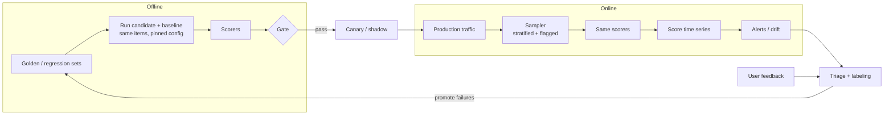

# Online and offline scoring: overview

**Scoring** turns the behavior of an AI application into numbers you can trend, compare and gate on. There are two complementary modes, and mature teams run both from the same scorers.

| | **Offline scoring** | **Online scoring** |
|---|---|---|
| **Runs on** | A fixed dataset (golden set, regression set, replayed traffic) | Live production traces |
| **When** | Before a change ships (CI, nightly), and on demand | Continuously, after the response is served |
| **Question answered** | "Is this change safe and better?" | "Is production healthy right now, and this quarter?" |
| **Ground truth** | Available (reference answers, expected sources, labels) | Usually absent: reference-free scorers, user signals |
| **Inputs** | Controlled, comparable run to run | The real, shifting distribution |
| **Cost control** | Run everything; the dataset is bounded | Sample; tier scorers by cost |
| **Failure mode** | Dataset goes stale; overfitting to the set | Biased samples; judge drift; noisy small-n dips |
| **Output** | Pass/fail gate, comparison report | Score time series, alerts, review queues |
| **Latency budget** | Minutes to hours | Seconds to minutes, **off the request path** |

The loop is the point: **offline gates stop known regressions, online scoring finds the unknown ones, and triage turns production failures into new offline test cases.**

## One scorer library, two modes

Write scorers once and run them in both places. Then an online score of 0.82 and an offline score of 0.82 mean the same thing, and you can reconcile them.

| Scorer type | Example | Offline | Online | Cost |
|---|---|---|---|---|
| **Deterministic** | schema valid, citation present, required facts, banned terms, PII regex, SQL parses | ✅ all items | ✅ 100 % | ~free |
| **Reference-based** | exact/fuzzy match, required-fact recall, retrieval recall@k, execution accuracy | ✅ | ❌ (no reference) | low |
| **Heuristic / embedding** | answer-to-context similarity, length, language | ✅ | ✅ 100 % | low |
| **Model-as-judge (reference-free)** | groundedness, relevance, tone, safety | ✅ | ✅ sampled | medium |
| **Model-as-judge (reference-aware)** | correctness vs a reference | ✅ | ❌ | medium |
| **Human review** | expert labels, calibration | ✅ small sets | ✅ queue | high |
| **User signals** | thumbs, edits, escalation, abandonment | ❌ | ✅ | free, sparse, biased |

## Which mode for which decision

| Decision | Use |
|---|---|
| Ship a prompt, model, retrieval or chunking change? | Offline gate, then canary with online scoring |
| Is the system degrading this week? | Online score trend vs baseline |
| Compare two models or configs fairly | Offline, paired, same items, repeated runs |
| Catch provider-side silent model updates | Online trend + a nightly offline run on a fixed anchor set |
| Find failure modes you did not anticipate | Online flagged traces, user feedback, clustering |
| Prove compliance / audit evidence | Offline run records + online score history, both versioned |
| Calibrate and validate a judge | Offline, against human labels |

## Where to go next

* [Offline scoring](offline-scoring.md): datasets, scorers, comparison statistics, gates, CI.
* [Online scoring](online-scoring.md): sampling, async scoring, write-back, alerting on noisy signals, shadow and A/B.
* [Designing scorers](designing-scorers.md): judges, rubrics, calibration, bias, versioning.
* [By application type](by-app-type.md): RAG, agents, chatbots, extraction, text-to-SQL, copilots.
* [Operating a scoring program](operating.md): cost, drift, reconciling online and offline, the improvement loop, anti-patterns.
* Runnable code: [`examples/scoring/`](https://github.com/akashtalole/ai-observability/tree/main/examples/scoring) and the live online scores in the [use cases](../use-cases/index.md).
