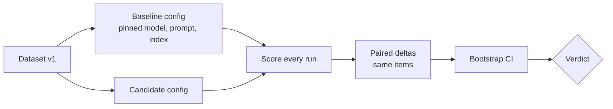

# Offline scoring

Offline scoring evaluates a system against a **fixed dataset** under controlled conditions. It is your regression test suite and your experiment bench.

## 1. Build the datasets

| Dataset | Purpose | Size to start | Source |
|---|---|---|---|
| **Golden set** | Curated, high-quality items with expected outcomes; the release gate | 200-1000 | SMEs + sampled production queries, labeled |
| **Regression set** | Every past failure, kept forever | grows | Promoted from incidents, thumbs-down, escalations |
| **Adversarial / safety set** | Injection, jailbreak, PII, policy edge cases, unanswerable questions | 100-300 | Red team, OWASP LLM Top 10 patterns |
| **Anchor set** | Frozen slice re-scored on every judge or model change to keep trends comparable | 50-200 | Subset of golden |
| **Replay set** | Redacted production traffic for latency/cost realism | 1 day of traffic | Trace store |
| **Holdout** | Never used for tuning prompts; detects overfitting | 20 % of golden | Split once, freeze |

Rules of thumb:

* **Stratify** by intent, difficulty, tenant tier, language and channel; report per slice, because averages hide regressions in important slices.
* Include **unanswerable** and **multi-hop** items; test abstention as a first-class behavior.
* Store provenance per item: source, labeler, date, guideline version. Version the dataset (`golden@2026-10-14`).
* For stochastic systems, run **each item several times** (3-20) and score every run.
* Keep personal data out of datasets; redact production-derived items.

## 2. Choose scorers

Prefer cheap, deterministic scorers wherever they are valid, and add judges only for what code cannot check ([Designing scorers](designing-scorers.md)).

* **Task-level:** required-fact recall, exact/fuzzy match, execution accuracy, schema validity.
* **Component-level** (find *where* it broke): retrieval recall@k / MRR / nDCG, reranker lift, tool-selection accuracy, argument validity.
* **System-level:** groundedness, answer relevance, safety, abstention accuracy, format.
* **Operational, scored alongside quality:** latency (p50/p95, TTFT), tokens, cost per request. A "better" answer that is 3× the cost is a trade-off, not a win.

## 3. Compare fairly



* **Pin everything** that is not under test: model version, temperature/seed, prompt, index snapshot, tool stubs/recorded responses, judge model and rubric.
* **Paired comparison:** compute the per-item difference candidate − baseline, then a bootstrap confidence interval on the mean difference. Paired tests are far more sensitive than comparing two means.
* **Decide with intervals, not point estimates.** "+0.02 [-0.02, +0.06]" is not an improvement.
* Report **effect size and sample size** next to every number; use more repeats rather than more adjectives.
* Beware **multiple comparisons**: checking 30 metrics will show a "significant" change by chance. Pre-declare the primary metrics.

## 4. Gate

A gate has four kinds of conditions; fail the build if any is violated.

| Condition | Example |
|---|---|
| Absolute floor | groundedness ≥ 0.85; citation present ≥ 0.90 |
| No significant regression | upper bound of CI of delta ≥ −0.02 |
| **Slice protection** | no intent drops more than 0.10 |
| Hard safety | 0 critical failures on the safety set; PII leak rate = 0 |
| Operational | p95 latency ≤ 1.10× baseline; cost ≤ 1.15× baseline |

Runnable reference: [`examples/scoring/offline_eval.py`](https://github.com/akashtalole/ai-observability/blob/main/examples/scoring/offline_eval.py) implements paired bootstrap, floors, slice protection and cost/latency gates; the exit code is the gate result.

```text
$ python examples/scoring/offline_eval.py
metric                baseline candidate    delta   95% CI of delta        gate
required_facts           0.894     0.917   +0.023   [-0.015, +0.060]   ok
citation_present         0.942     0.967   +0.025   [-0.013, +0.067]   ok
...
GATE: PASS

$ python examples/scoring/offline_eval.py --candidate degraded
GATE: FAIL
  - required_facts: candidate 0.685 (floor 0.8); delta -0.208 CI [-0.258,-0.158]
  - slice billing: required_facts 0.89 -> 0.65
```

## 5. Wire it into delivery

| Stage | What runs | Budget |
|---|---|---|
| Pull request | Fast subset (≈ 50-100 items) + deterministic scorers | < 5 min |
| Merge / nightly | Full golden + regression + adversarial, repeats, judges | < 1-2 h |
| Pre-release | Full + replay set for latency/cost, anchor-set judge check | hours |
| Post-deploy | Same scorers online on the canary slice ([Online scoring](online-scoring.md)) | continuous |

See also [Evals in CI/CD](../implementation/evals-in-ci.md) for a workflow definition.

## 6. Record the run

Every offline run should write a record, so a trend and an audit are possible months later:

```json
{
  "run_id": "2026-10-14T02:00Z-nightly",
  "dataset": "golden@2026-10-14", "dataset_items": 600, "repeats": 5,
  "system": {"git_sha": "a1b2c3d", "prompt": "faq-answer@v8", "model": "large-model-2026-09", "index": "kb-main@2026-10-01"},
  "judge": {"model": "judge-small-2026-08", "rubric": "groundedness@v3"},
  "scores": {"groundedness": {"mean": 0.874, "ci95": [0.861, 0.887], "n": 3000}},
  "slices": {"billing": {"required_facts": 0.89}},
  "ops": {"latency_p95_s": 3.9, "cost_per_request_usd": 0.0088},
  "gate": "pass"
}
```

Emit the same fields as metrics (for example `eval.offline.score{metric,dataset,config}`) so the **offline score history appears on the same Grafana dashboards as online scores**, annotated by release.

## Pitfalls

| Pitfall | Fix |
|---|---|
| Golden set drifts from real traffic | Refresh monthly from production; track the share of production intents covered |
| Overfitting prompts to the golden set | Frozen holdout; rotate items; watch the holdout-vs-golden gap |
| Judge changes break trend continuity | Version judges; re-score the anchor set on every change |
| Flaky gate (single stochastic run) | Repeats + paired CI; fail only on significant regressions |
| Tool/API nondeterminism in agent evals | Record and replay tool responses; evaluate trajectory *and* outcome |
| Contamination (test items in few-shot or fine-tune data) | Keep eval items out of prompts and training; hash-check |
