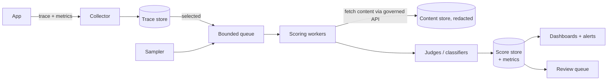

# Online scoring

Online scoring evaluates **live production traffic**, with no reference answers, so you can see quality as users experience it and catch what the golden set never imagined.

## Principles

1. **Never on the request path.** Serve the user first; score asynchronously. A judge outage must not become a user outage.
2. **Cheap on everything, expensive on a sample.** Deterministic checks and heuristics on 100 %; LLM judges on a stratified sample plus all flagged requests.
3. **Score, then write back with identity.** Store `(trace_id, metric, score, scorer_version, judge_model, ts)` so any score can be sliced by any trace attribute: tenant, prompt version, index version, model.
4. **Read scores with their sample size.** A dip on 12 samples is noise; show n and an interval on every chart.
5. **Version the scorer.** A change in judge or rubric is a change in the measuring instrument; annotate it and re-score an anchor slice.

## Architecture



The runnable reference [`examples/scoring/online_scorer.py`](https://github.com/akashtalole/ai-observability/blob/main/examples/scoring/online_scorer.py) shows the sampler, bounded queue with load shedding, versioned write-back and interval reporting. The [use cases](../use-cases/rag.md) emit the scores as OpenTelemetry histograms (`rag_eval_score{metric="groundedness"}`) with an `eval_queue_age` gauge, linked to the original trace.

## What to score, and how often

| Tier | Scorers | Coverage | Purpose |
|---|---|---|---|
| **T0: inline cheap checks** | schema valid, citation present, length, language, PII regex, banned terms, retrieval empty/low score | 100 %, in-process (microseconds) | Flag bad responses immediately; drive tail sampling |
| **T1: async heuristics** | answer-to-context overlap, embedding similarity, toxicity classifier (small model) | 100 % or high sample | Cheap trend signal |
| **T2: sampled LLM judge** | groundedness, relevance, task success, policy compliance | 2-10 % stratified + all flagged | The quality time series |
| **T3: escalated judge / panel** | strong or multi-judge ensemble on contested items | flagged + disagreements | Reduce judge error where it matters |
| **T4: human** | expert review queue | small, targeted | Ground truth and judge calibration |

Cheap flags decide who gets the expensive judge: set `eval.flagged=true` on the span for empty retrieval, guardrail hits, thumbs-down, slow or costly requests, and use [tail sampling](../implementation/collector-pipeline.md) to keep those traces.

## Sampling

* **Stratify** by `app × tenant tier × intent × risk tier`. Oversample high-risk and rare strata, otherwise rare intents never get a score.
* **Always score** flagged requests (they are your triage queue) **plus a small uniform random slice** that is your unbiased estimator.
* **Do not pool the two.** Flagged traces are over-represented in bad outcomes. Report the random slice as the health metric and the flagged slice as a work queue; the demo script prints them separately.
* Re-weight (inverse probability) if you must report a single population-level number from stratified samples.
* Shed load rather than block: a bounded queue, drop-oldest or drop-newest, and **measure what you shed** (`eval_shed_total`) so coverage stays honest.

## Making noisy scores actionable

| Technique | How |
|---|---|
| **Intervals and minimum n** | Alert only if n ≥ a floor (e.g. 200 per window) and the interval excludes the baseline |
| **Baseline bands** | Compare to a rolling 28-day median ± MAD, per slice, same hour-of-week |
| **Sequential tests / CUSUM** | Detect small persistent shifts earlier than fixed thresholds |
| **Slice-aware alerts** | Alert on the worst important slice, not only the aggregate |
| **Pair with leading indicators** | Retrieval top-1 score, empty-retrieval rate, index age: they move before judged quality does |
| **Combine signals** | Quality alert = judge dip **and** retrieval dip **or** thumbs-down rise; fewer false pages |

Example (PromQL) for a sample-size-guarded quality alert, as used in the [RAG rules](https://github.com/akashtalole/ai-observability/blob/main/use-cases/rag/alerts/rag-alerts.yml):

```promql
rag:groundedness:mean5m < 0.8
and
sum(increase(rag_eval_score_count{metric="groundedness"}[5m])) >= 5
```

## Online experiments

| Pattern | What it is | Use for |
|---|---|---|
| **Shadow** | Run candidate on a copy of traffic, score it, never show it | Safe pre-launch comparison on real inputs; costs extra inference |
| **Canary** | Send a small share to the candidate; auto-compare scores, latency, cost; auto-rollback | Gradual rollout |
| **A/B test** | Randomize users; compare scores **and** outcomes (resolution, task success) | Product decisions |
| **Interleaving / pairwise judge** | Judge A vs B answers to the same query | Sensitive comparison with fewer samples |

Always compare **same slice, same scorer version, same period**; randomize at the user or conversation level, not per request, for multi-turn apps.

## User and business signals

Thumbs, edits, copy, regeneration, abandonment, escalation, ticket re-open, task completion. They are free and real but **sparse, biased towards extremes, and delayed**. Use them as a triage and calibration input (join to traces by `trace_id`), not as the only quality metric. Convert implicit signals into scored events (`feedback.rating`, `outcome.resolved`) and trend them next to judge scores; disagreement between them points at a bad judge or a bad rubric.

## Privacy and governance

* Workers fetch content through a **governed, audited API** with redaction; scores and metadata flow to the observability stack, raw content does not.
* Respect data residency and tenant isolation in the scoring path (the judge sees customer content).
* Record scorer versions and judge models in the score record; retain them as audit evidence.
* Judges are LLM calls: apply the same budget, rate limits and failure handling as the product.

## Pitfalls

| Pitfall | Fix |
|---|---|
| Judging 100 % of traffic with a frontier model | Tiering and sampling; measure judge cost as a first-class metric |
| Pooling flagged and random samples | Report separately; reweight if combined |
| Alerting on every score wobble | Minimum n, intervals, baseline bands |
| Judge on the request path | Async workers, bounded queue, shed and measure |
| Silent judge change | Version judges; anchor-set re-score; annotate dashboards |
| Scores that cannot be traced back | Always write `trace_id`; link scores, traces, logs |
