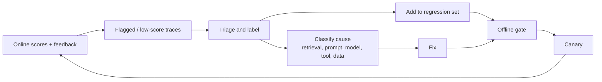

# Operating a scoring program

## Cost model

```text
online judge cost/day  = requests/day x sample_rate x judge_calls_per_item x cost_per_judge_call
offline run cost       = dataset_items x repeats x (system_cost + scorer_cost) x runs/day
```

Example: 2 M requests/day, 4 % judged, one judge call at $0.0006 → ≈ $48/day. Judging 100 % with a frontier-model judge at $0.01 → $20,000/day: 400× more, for little extra statistical power.

Levers: tier scorers (T0-T4), stratified sampling, small-model judges calibrated against a strong judge, cached judge results for identical inputs, shorter judge inputs (claims instead of full documents), batch APIs for offline runs. Track **judge cost per scored item** and **scoring cost as a share of inference spend** as metrics (target under ~5-10 %).

## Statistics you actually need

| Need | Method |
|---|---|
| Interval for a mean score | Normal approx. (large n) or bootstrap |
| Interval for a pass-rate | Wilson interval |
| Compare two configs on the same items | Paired bootstrap on per-item differences |
| Compare two online arms | Two-sample test / bootstrap on per-user (not per-request) means |
| Sample size for a detectable change | n ≈ 2(2.8·σ/δ)² per arm for 95 % confidence and 80 % power (δ = smallest change you care about, σ = score std-dev) |
| Detect small persistent shifts | CUSUM / EWMA on the score series |
| Many metrics at once | Pre-declare primary metrics; correct (Holm/Benjamini-Hochberg) for the rest |

Example: with σ = 0.11 and δ = 0.02, n ≈ 2 × (2.8 × 0.11 / 0.02)² ≈ 470 judged items per arm per window. That is why alerts need minimum-n guards and why rare slices need oversampling.

## Reconciling online and offline

They disagree for known reasons; investigate rather than pick a winner.

| Symptom | Likely cause |
|---|---|
| Offline high, online low | Golden set unrepresentative; production distribution shifted; data freshness; real user phrasing |
| Offline low, online high | Reference-based scorer too strict; golden set harder than traffic |
| Same scorer, different mean | Different judge version, prompt, or context truncation between the two paths |
| Online dip, offline stable | Drift in inputs or index, provider-side change, a slice not in the dataset |
| Offline gate passes, canary fails | Missing operational realism (load, tools, latency), caching differences |

Practices: run the **same scorer code and version** in both modes; re-score a sample of production items offline under controlled config; measure the golden-set **coverage of production intents**; alert when coverage falls.

## The improvement loop



Weekly: review the lowest-scoring and most-disagreed traces; promote failures to the regression set; refresh 5-10 % of the golden set; review judge-human agreement on a sample; check alert noise.

## Governance and audit

* Keep **score history, scorer versions, dataset versions and gate decisions** as audit evidence (EU AI Act post-market monitoring, NIST AI RMF "Measure", ISO/IEC 42001).
* Tier by risk: high-risk apps get higher sampling, human review queues and stricter gates ([risk tiers](../monitoring/overview.md#risk-tiering-the-depth-of-monitoring)).
* Restrict who can edit gates and rubrics; changes are reviewed like code.

## Anti-patterns

| Anti-pattern | Fix |
|---|---|
| Scores without n or intervals | Always show both |
| Gating on a single stochastic run | Repeats + paired CI |
| Optimizing the metric, not the outcome | Tie scores to business outcomes (resolution, task success, edits) and check correlation periodically |
| Static golden set | Continuous promotion from production |
| One aggregate number | Per-slice reporting and slice-protection gates |
| Unowned scorers | Each scorer has an owner, a version, a calibration record and a review cadence |

## Checklist

- [ ] Deterministic checks on 100 % online and offline
- [ ] Golden, regression, adversarial, anchor and holdout sets versioned
- [ ] CI gate with paired CIs, slice protection, hard safety and ops gates
- [ ] Online sampler: stratified + flagged, bounded queue, shed counter
- [ ] Judges calibrated (κ reported), pinned, versioned; anchor re-score on change
- [ ] Scores written with `trace_id`, `scorer_version`, `judge_model`
- [ ] Dashboards show score, n, interval, scorer version and change events
- [ ] Alerts guarded by minimum n; slice-aware
- [ ] Weekly triage → regression-set promotion
- [ ] Scoring cost tracked and capped
