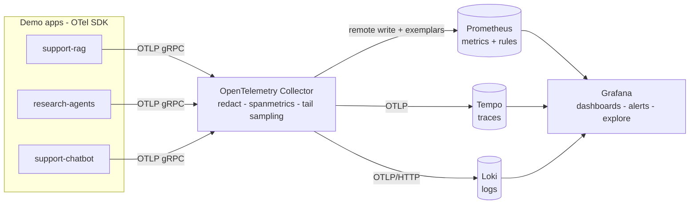
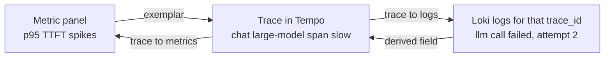

# Use cases: implementations on the open-source stack

Runnable reference implementations of the handbook's guidance using **OpenTelemetry, Prometheus, Grafana, Loki and Tempo** — no vendor SDKs, no API keys. Each use case ships an instrumented demo app, dashboards, alert rules and a runbook-linked failure-scenario simulator.

| Use case | Service | What it demonstrates | Page |
|---|---|---|---|
| **RAG** | `support-rag` | Per-stage latency, TTFT, cost per request, online quality scores, retrieval health, index freshness, cache, retries/fallbacks | [RAG](rag.md) |
| **Multi-agent** | `research-agents` | Task success, steps, trajectories, tool errors, handoffs, loops, budgets, approvals, indirect prompt injection | [Multi-agent](multi-agent.md) |
| **Chatbot** | `support-chatbot` | Containment, escalation, abandonment, TTFT, refusal vs over-refusal, context utilization, cost per conversation | [Chatbot](chatbot.md) |



## Quick start

```bash
pip install -r use-cases/requirements.txt

# 1. Start the stack (needs Docker)
docker compose -f use-cases/stack/docker-compose.yml up -d

# 2. Start any demo app; --cycle rotates failure scenarios every N seconds
python use-cases/rag/app/rag_app.py              --rps 3   --cycle 240 &
python use-cases/multi-agent/app/agent_app.py    --rps 0.7 --cycle 240 &
python use-cases/chatbot/app/chatbot_app.py      --rps 0.6 --cycle 240 &

# 3. Open Grafana (anonymous admin, demo only): http://localhost:3000
#    Folders: rag / multi-agent / chatbot / platform
```

!!! tip "Choosing `--cycle`"
    Make each phase longer than the alert rule window plus its `for:` duration (demo rules use 2-3 minute windows and `for: 1m`), otherwise the fault ends before its alert can fire. 240 s works for all three apps.

No Docker? The apps run standalone and print their telemetry: `python use-cases/rag/app/rag_app.py --console --duration 10`.

## One request, all three signals

The point of the stack is **correlation**: every pivot below is wired in the provisioned Grafana datasources.



1. **Metrics → trace:** histogram panels show exemplar dots; click one to open the exact slow request in Tempo.
2. **Trace → logs:** the trace view links to Loki filtered by `trace_id` (logs carry it as structured metadata).
3. **Logs → trace:** a `trace_id` field in any log line is a link back to Tempo.
4. **Trace → metrics:** span metrics (`traces_span_metrics_*`, computed from 100 % of spans before sampling) give RED per model, agent or tool.

## What was verified

These configurations were run for real: the Collector, Prometheus, Loki, Tempo and Grafana 11 were started with the files in this repo (natively, since the build sandbox has no Docker daemon), the three apps ran through full scenario cycles, `otelcol validate` and `promtool check rules` passed, all 7 dashboards were provisioned, `scripts/verify_dashboards.py` executed every panel query through Grafana's API with **0 errors**, and fault scenarios were pinned one at a time to calibrate alert thresholds against real values. Calibration was completed for the RAG faults and several agent/chatbot faults; the remaining scenarios (agent `injection`, `slow-tool`, `runaway-loop`; chatbot `slow-model`) were not re-run after the final threshold changes, so expect to tune thresholds for your traffic. The Docker Compose file itself was not executed.

## Map to the handbook

| Handbook guidance | Where it is implemented here |
|---|---|
| [Metrics catalog](../metrics/metrics-catalog.md) | Metric names per use case, listed on each page |
| [SLOs & alerting](../metrics/slos-alerting.md) | `*/alerts/*.yml`: multi-window burn rate, baseline-relative spikes, minimum-sample guards |
| [Collector & pipeline](../implementation/collector-pipeline.md) | `stack/otel-collector.yaml`: metrics before sampling, redaction, tail sampling |
| [Storage & retention](../architecture/storage-and-retention.md) | Tempo 14 d / Loki 14 d / Prometheus 90 d + daily recording rules; path to Mimir/ClickHouse in [the stack page](stack.md) |
| [Runbooks](../operations/runbooks.md) | Alert annotations link to the matching runbook section |
| [Security & privacy](../architecture/security-privacy.md) | Apps emit IDs, lengths and scores only; Collector deletes `gen_ai.prompt`/`completion` as a safety net |
