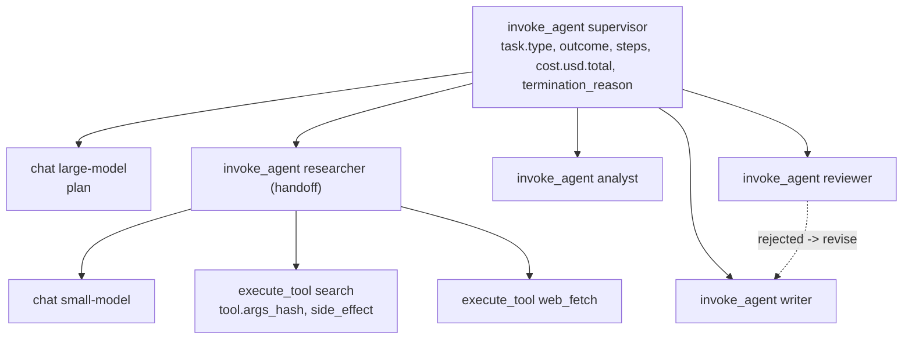

# Use case: Multi-agent

**Service `research-agents`**: a supervisor that plans and hands off to `researcher`, `analyst`, `writer` and `reviewer` agents, which call tools (`search`, `kb_lookup`, `web_fetch`, `run_code`, `send_email`). Includes human approval for write tools, loop detection, and step/budget/timeout limits.
Code: [`use-cases/multi-agent/`](https://github.com/akashtalole/ai-observability/tree/main/use-cases/multi-agent) · Theory: [Monitoring agents](../monitoring/agents.md).

Agents make cost, latency and failure **path-dependent**: the same task can take 6 steps or 25. So you observe *trajectories*, not single calls.

```bash
python use-cases/multi-agent/app/agent_app.py --rps 0.7 --cycle 240
python use-cases/multi-agent/app/agent_app.py --scenario runaway-loop
python use-cases/multi-agent/app/agent_app.py --console --duration 15
```

## Trace anatomy (one trace per task)



* Span kinds follow the OTel GenAI agent conventions: `invoke_agent`, `chat`, `execute_tool`, with `gen_ai.agent.name` and `gen_ai.tool.name`.
* Tool arguments are **hashed** (`tool.args_hash`), never recorded: enough to detect loops, safe for privacy.
* Failed or abandoned tasks set `eval.flagged=true`, so the tail sampler **keeps every bad trajectory**.

## Metrics

| OTel name | Prometheus name | Key labels | Answers |
|---|---|---|---|
| `agent.tasks` | `agent_tasks_total` | `outcome` (success/failed/abandoned), `task_type` | Success rate |
| `agent.task.duration` | `agent_task_duration_seconds_*` | `outcome`, `task_type` | Time to complete |
| `agent.task.steps` | `agent_task_steps_*` | `task_type` | Efficiency / runaway |
| `agent.task.cost` | `agent_task_cost_*` | `task_type` | Cost per task (histogram, USD) |
| `agent.cost.usd`, `agent.tokens` | `agent_cost_usd_total`, `agent_tokens_total` | `agent`, `model`, `direction` | Which agent spends |
| `agent.llm.calls`, `agent.llm.duration` | `agent_llm_calls_total`, `agent_llm_duration_seconds_*` | `agent`, `model` | Reasoning load |
| `agent.tool.calls`, `agent.tool.duration` | `agent_tool_calls_total`, `agent_tool_duration_seconds_*` | `tool`, `status` (ok/error/denied), `agent` | Tool health |
| `agent.handoffs` | `agent_handoffs_total` | `from`, `to` | Coordination pattern |
| `agent.loops.detected` | `agent_loops_detected_total` | `agent`, `tool` | Same tool + args repeated ≥ 3× |
| `agent.terminations` | `agent_terminations_total` | `reason` (max_steps, budget_exceeded, timeout, loop) | Guardrails firing |
| `agent.approvals` | `agent_approvals_total` | `decision`, `tool`, `agent` | Human-in-the-loop on side effects |
| `agent.guardrail.events` | `agent_guardrail_events_total` | `category`, `action` (blocked/missed) | Indirect prompt injection |
| `agent.plan.revisions` | `agent_plan_revisions_total` | `cause` (tool_failure, rejected) | Plan thrash |
| `agent.active_tasks` | `agent_active_tasks` |  | In-flight work |

Span-derived RED metrics (`traces_span_metrics_calls_total`, `traces_span_metrics_duration_milliseconds_*`) come from the Collector's `spanmetrics` connector with `gen_ai_agent_name` and `gen_ai_tool_name` dimensions, giving per-agent and per-tool rate/error/duration from 100 % of spans.

## Dashboards

Folder **multi-agent**:

| Dashboard | Use |
|---|---|
| **Multi-agent: Tasks, Trajectories & Cost** | Selected-range KPIs + Δ, then Outcomes & efficiency, Agents/tools/handoffs, Safety & governance, Logs & traces. Variable: `task_type` |
| **Multi-agent: Trends** | Daily success rate and cost per task, week-over-week |

!!! tip "The number to manage"
    **Cost per successful task**, not cost per call. Read *Cost per task* beside *Task success rate*: a cheaper agent that fails more is more expensive per outcome.

## Alerts

[`use-cases/multi-agent/alerts/agent-alerts.yml`](https://github.com/akashtalole/ai-observability/blob/main/use-cases/multi-agent/alerts/agent-alerts.yml)

| Alert | Signal |
|---|---|
| `AgentTaskSuccessLow` | Success < 70 % with traffic |
| `AgentRunawaySteps` | p95 steps per task > 23 (hard limit 25; healthy p95 ≈ 19-20). Safety net: in the demo the loop guard stops loops first, so no scenario reaches it |
| `AgentLoopsDetected` | > 5 repeated identical tool calls in 5 min |
| `AgentCostPerTaskSpike` | Cost/task > 2.5× its 30-minute median |
| `AgentBudgetExceededTerminations` | Any task hit the per-task USD budget |
| `AgentToolErrorRateHigh` | Tool error ratio > 10 % (healthy ≈ 1-2 %) |
| `AgentTaskLatencyHigh` | Task p95 duration > 45 s |
| `AgentInjectionMissed` | Indirect injection reached the agent undetected (**page**) |

## Failure scenarios

--8<-- "use-cases/_generated/scenarios-multi-agent.md"

## Query cookbook

```promql
# cost per *successful* task (reconcile cost with outcomes)
sum(increase(agent_cost_usd_total[1d])) / sum(increase(agent_tasks_total{outcome="success"}[1d]))

# which tool is failing
sum by (tool) (rate(agent_tool_calls_total{status="error"}[5m])) / sum by (tool) (rate(agent_tool_calls_total{status!="denied"}[5m]))

# how often each guard stops a task
sum by (reason) (increase(agent_terminations_total[1h]))

# handoff graph weights
sum by (from, to) (increase(agent_handoffs_total[1h]))
```

```traceql
{ resource.service.name = "research-agents" && name = "invoke_agent supervisor" && span.app.task.outcome != "success" }
{ span.loop.detected = true }
{ span.tool.side_effect = "write" && span.approval.granted = false }
{ resource.service.name = "research-agents" && span.gen_ai.tool.name = "web_fetch" && status = error }
```

```logql
{service_name="research-agents"} |= "task terminated"
{service_name="research-agents"} |= "indirect prompt injection"
```

## Taking it to production

* Put **hard limits** in the framework (max steps, tokens, wall clock, USD) and emit `agent.terminations` when they trigger; alert on the *rate* of terminations.
* Use your orchestrator's callbacks (LangGraph, OpenAI Agents SDK, Semantic Kernel, AutoGen, CrewAI, …) or its OTel support to create `invoke_agent` / `execute_tool` spans; keep the attributes above.
* Evaluate trajectories offline (tool choice, step efficiency vs a reference) and outcomes online; see [Evaluation](../metrics/evaluation.md).
* Treat tool outputs as untrusted: log injection verdicts, require approval for side effects, record denials.
* See [Adapting to your app](adapting.md).
