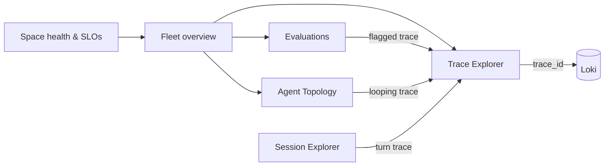

# Omni-style Grafana dashboards

Six Grafana dashboards that reproduce the **working surfaces of Amazon CloudWatch Omni's agent observability** on the open-source stack (OpenTelemetry Collector, Prometheus, Tempo, Loki, Grafana). They read the data the three [demo apps](index.md) already emit, so they work out of the box, and they work for any application that follows the [telemetry contract](../cloud-native/implementation-guide.md#4-the-telemetry-contract).

Source: [`use-cases/omni-style/`](https://github.com/akashtalole/ai-observability/tree/main/use-cases/omni-style) · generator: [`scripts/gen_omni_dashboards.py`](https://github.com/akashtalole/ai-observability/blob/main/scripts/gen_omni_dashboards.py) · background on Omni: [CloudWatch Omni](../cloud-native/omni.md).

!!! warning "What this is modelled on"
    The Omni dashboard link that prompted this work is behind AWS sign-in and could not be opened, so the dashboards are modelled on Omni's **publicly documented** surfaces (Trace Explorer with compare mode, Session Explorer, Agent Topology, evaluators, Spaces with SLOs). They are a functional equivalent, **not a pixel copy**. If you share screenshots or an export of the specific Omni view you want, the layout can be matched more closely.

## Mapping: Omni surface → Grafana dashboard

| Omni surface | Grafana dashboard (`omni-style` folder) | What it gives you |
|---|---|---|
| **Space**: team's applications, SLOs, alarms, investigations | **Space health & SLOs** (`omni-space-health`) | Per-application availability, latency, **error budget left** and burn rate; firing alerts and alert history; change events; discovered models/tools; links into the explorers |
| Application / agent list, fleet view | **Agent fleet overview** (`omni-agent-overview`) | KPIs vs previous period, applications table, per-agent table, traffic/latency/error by app, LLM calls and latency by model, tokens, spend, tool latency |
| **Trace Explorer** (+ compare mode) | **Trace Explorer** (`omni-trace-explorer`) | TraceQL search with filters (service, min duration, status), click a `traceID` to open the hierarchical timeline (LLM calls, tool invocations), **compare two traces side by side**, slowest operations, logs for the selected trace |
| **Session Explorer** (multi-turn) | **Session Explorer** (`omni-session-explorer`) | Conversation health (containment, escalation, abandonment, turns per conversation), browse sessions by `gen_ai.conversation.id`, turns of a selected session, trace timeline |
| **Agent Topology** | **Agent Topology** (`omni-agent-topology`) | Handoff matrix (from → to), tool-usage matrix (agent × tool), per-edge calls/error ratio, per-agent LLM calls, latency and spend, loops and terminations |
| **Evaluators**, regression detection | **Evaluations** (`omni-evaluations`) | Evaluator scorecards with Δ vs previous period, score-distribution **heatmaps**, pass rates, scored-sample counts, now-vs-earlier regression check, flagged traces and judge-run spans |

All six share a **dashboard navigation bar** (tag `omni-style`) so they feel like one app, and carry the `service` variable where it applies.



## How the data flows

| Panels | Data source | Based on |
|---|---|---|
| Fleet/Space RED (requests, errors, latency by app, model, tool) | Prometheus | **Span metrics** from the Collector (`traces_span_metrics_calls_total`, `…duration_milliseconds_bucket`) with `gen_ai_*` dimensions, computed from 100 % of spans before sampling |
| Per-agent, handoffs, tool usage, evaluator scores, sessions, cost | Prometheus | App metrics (`agent_*`, `rag_*`, `chat_*`) described on the [use-case pages](index.md) |
| Trace search, timeline, compare, sessions, flagged traces | Tempo | TraceQL over `gen_ai.*`, `app.*`, `eval.flagged` attributes |
| Logs for a trace, change events, warnings | Loki | `trace_id` structured metadata; "scenario change" log lines (replace with your deploy events) |
| Alerts | Prometheus | `ALERTS` series from the rule files in `use-cases/*/alerts` |

!!! note "Shared helper fix made while building these"
    The demo apps' histogram bucket views were also matching score/count histograms, emitting two bucket sets for one metric and corrupting `histogram_quantile()` (visible as a stray 64/16/4/1 axis on the evaluation heatmaps). `use-cases/common/telemetry.py` now applies the latency buckets only to histograms with unit `s`.

!!! note "Collector setting that matters"
    These dashboards rely on `spanmetrics` with **`metrics_flush_interval: 15s`** (set in `stack/otel-collector.yaml`). With the 60 s default, a 1-minute `rate()` window contains at most one sample and the span-metric time series stay empty.

## Run it

```bash
pip install -r use-cases/requirements.txt
docker compose -f use-cases/stack/docker-compose.yml up -d        # Grafana http://localhost:3000, folder "omni-style"
python use-cases/rag/app/rag_app.py --rps 3 --cycle 240 &
python use-cases/multi-agent/app/agent_app.py --rps 0.9 --cycle 240 &
python use-cases/chatbot/app/chatbot_app.py --rps 0.6 --cycle 240 &
```

Suggested walkthrough (about five minutes):

1. Open **Space health**: watch an application's error budget and burn rate react as scenarios rotate; open a firing alert.
2. Jump to **Fleet overview**, find the application with rising p95 or spend.
3. Open **Trace Explorer**, filter `errors` or `> 5s`, click a `traceID`, read the timeline; paste a healthy trace ID into *compare with trace ID* to compare.
4. In **Agent Topology**, look at the tool-usage matrix during `tool-flaky` or `runaway-loop`, then open a looping trace.
5. In **Evaluations**, watch groundedness and its distribution heatmap shift during `bad-index`; open the flagged traces.
6. In **Session Explorer**, copy a conversation ID from the table into the *session* variable.

## Verified and not verified

* The Collector, Prometheus, Tempo, Loki and Grafana 11 were run with these dashboards provisioned. `scripts/verify_dashboards.py` executed every panel query through Grafana's API (and TraceQL/trace-by-ID through the Tempo proxy) with **0 errors**. Panels that depend on history (Δ vs previous period, "now vs one hour earlier") need more than a few minutes of data, and some panels are empty until the matching fault scenario occurs (for example loop detections). The `docker compose` stack itself was not executed.
* The trace timeline and compare panels show an error icon until a trace ID is selected (they query a dashboard variable that starts empty).
* Table joins/matrices and heatmaps were checked for query success, not pixel-by-pixel appearance in every Grafana version.

## What is deliberately not reproduced

| Omni capability | Why / alternative |
|---|---|
| **Ask Assistant**, AI investigations with DevOps Agent, natural-language queries | Product-specific AI features. See [AI for observability](../ai-and-observability/ai-for-observability.md) for building read-only, evidence-citing assistants over this data |
| **Playground**, **Experiments**, golden datasets from traces, prompt management | Offline-evaluation workflow. Use the [offline scoring gate](../scoring/offline-scoring.md) in CI; push results as a metric to chart variants |
| **Agent Topology as a node-link graph** | Grafana's node graph needs a node/edge data source; the matrices and edge tables carry the same information |
| **Automatic service discovery from AWS Config, alarm auto-tuning** | AWS-specific; here, services and models/tools are discovered from span attributes and alert rules are code |
| **IDE extension** | Out of scope; traces open in Grafana |

## Adapting to your agents

1. Emit the [telemetry contract](../cloud-native/implementation-guide.md#4-the-telemetry-contract): `invoke_agent` / `chat` / `execute_tool` spans with `gen_ai.agent.name`, `gen_ai.tool.name`, `gen_ai.request.model`, `gen_ai.conversation.id`.
2. Keep the Collector's `spanmetrics` dimensions (`gen_ai.agent.name`, `gen_ai.tool.name`, `gen_ai.request.model`, `gen_ai.operation.name`) so the span-metric panels light up for your services automatically.
3. For the Evaluations dashboard, publish scores as histograms `<app>_eval_score{metric}` (see the [online scoring](../scoring/online-scoring.md) guide); copy the card list in `evaluations()` to add your evaluators.
4. For the agent matrices, publish `agent_handoffs_total{from,to}` and `agent_tool_calls_total{agent,tool,status}` or derive equivalents from spans.
5. Edit `scripts/gen_omni_dashboards.py` and regenerate; do not hand-edit the JSON.
