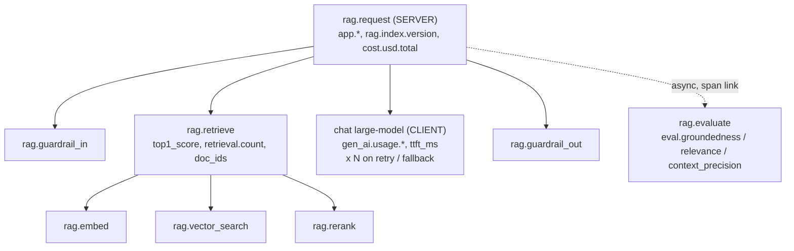

# Use case: RAG

**Service `support-rag`**: an enterprise knowledge assistant (embed → vector search → rerank → generate → guardrails) with a semantic cache, retry/fallback, and asynchronous online evaluation.
Code: [`use-cases/rag/`](https://github.com/akashtalole/ai-observability/tree/main/use-cases/rag) · Handbook theory: [RAG playbook](../rag/rag-observability-playbook.md), [RAG monitoring](../monitoring/rag.md).

**Goal:** see latency, quality and cost of the RAG app across any time range, catch regressions early, and track months of trends.

```bash
python use-cases/rag/app/rag_app.py --rps 3 --cycle 240          # rotates: normal, fault, normal, fault ...
python use-cases/rag/app/rag_app.py --scenario bad-index         # or pin one fault
python use-cases/rag/app/rag_app.py --console --duration 10      # print telemetry, no stack needed
```

## Trace anatomy



* Every root span carries the **change-attribution versions**: `app.release.id`, `app.prompt.version`, `rag.index.version`, `rag.embedding.model`, `gen_ai.response.model`.
* Retrieval spans store **doc IDs and scores, never chunk text**. Query length is recorded, not the query.
* Cheap deterministic checks (empty or low-similarity retrieval) set `eval.flagged=true`, so the **tail sampler keeps those traces** at 100 %.
* The LLM judge runs **off the request path** in a worker and links back to the original trace.

## Metrics

| OTel name | Prometheus name | Key labels | Answers |
|---|---|---|---|
| `rag.requests` | `rag_requests_total` | `status` (ok/error/blocked), `tenant`, `feature` | Volume, error ratio, availability SLO |
| `rag.request.duration` | `rag_request_duration_seconds_*` | `tenant`, `feature`, `status` | End-to-end p50/p95/p99 |
| `rag.ttft` | `rag_ttft_seconds_*` | `model`, `tenant` | Time to first token (UX) |
| `rag.stage.duration` | `rag_stage_duration_seconds_*` | `stage` | Which stage is slow |
| `rag.tokens` | `rag_tokens_total` | `direction`, `model`, `tenant` | Token usage |
| `rag.cost.usd` | `rag_cost_usd_total` | `model`, `tenant`, `feature` | Spend and cost per request |
| `rag.context_tokens` | `rag_context_tokens_*` |  | Context bloat |
| `rag.retrieval.top1_score` | `rag_retrieval_top1_score_*` |  | Retrieval confidence |
| `rag.retrieval.empty` | `rag_retrieval_empty_total` | `kind` (empty/low_score) | Coverage gaps |
| `rag.eval.score` | `rag_eval_score_*` | `metric` (groundedness, answer_relevance, context_precision) | **Quality** |
| `rag.eval.queue_age` | `rag_eval_queue_age_seconds` |  | Staleness of quality signal |
| `rag.index.age` | `rag_index_age_seconds` |  | Index freshness |
| `rag.llm.retries` / `rag.llm.fallbacks` | `rag_llm_retries_total` / `…_fallbacks_total` | `error_type`, `to` | Hidden latency/cost |
| `rag.cache.lookups` | `rag_cache_lookups_total` | `result` | Cache value |
| `rag.guardrail.events` | `rag_guardrail_events_total` | `category`, `action`, `direction` | Safety |
| `rag.feedback` | `rag_feedback_total` | `rating`, `feature` | User signal |

Resource labels added by the Collector: `service_name`, `deployment_environment`, `service_namespace`.

## Dashboards

Folder **rag** in Grafana (JSON in [`use-cases/rag/dashboards/`](https://github.com/akashtalole/ai-observability/tree/main/use-cases/rag/dashboards)):

| Dashboard | Use |
|---|---|
| **RAG: Latency, Quality & Cost** | KPI tiles for the selected range, Δ vs the previous period, then rows for Latency, Quality, Cost, Logs & traces. Variable: `tenant` |
| **RAG: Trends (weeks to months)** | Daily recording rules: p95, cost/request, groundedness, week-over-week deltas |

Reading the main dashboard:

1. **Top rows:** change vs previous period turns red when p95 latency or cost/request rises >5 % or groundedness drops.
2. **Latency:** if p95 rises, compare *Stage latency p95* and *Time spent per stage*: `llm` dominating means provider/model; `vector_search`/`rerank` means retrieval infrastructure.
3. **Quality:** read scores next to *Scored samples per minute*. A dip on thin samples is noise.
4. **Cost:** *Context tokens* and *tokens in vs out* explain most cost moves; *cost by tenant/feature* finds the owner.
5. **Triage:** click an exemplar dot, a TraceQL row, or a `trace_id` in the logs.

## Alerts

[`use-cases/rag/alerts/rag-alerts.yml`](https://github.com/akashtalole/ai-observability/blob/main/use-cases/rag/alerts/rag-alerts.yml); every alert links to a [runbook](../operations/runbooks.md) section.

| Alert | Signal | Why it matters |
|---|---|---|
| `RagErrorBudgetFastBurn` | Error ratio, multi-window burn rate on a 99.5 % SLO (demo: 2 m > 14.4× and 10 m > 3× budget) | Availability |
| `RagTTFTHigh` / `RagLatencyHigh` | TTFT p95 > 2 s; end-to-end p95 > 8 s | UX / SLO |
| `RagCostPerRequestSpike` | Cost/request > 2× its 30-minute median | Context bloat, retries, model change |
| `RagGroundednessLow` | Groundedness < 0.8 **and** ≥ 5 scored samples | Quality, with a minimum-sample guard |
| `RagRetrievalDegraded` | Empty/low-score retrieval > 5 % | Leading indicator of quality loss |
| `RagIndexStale` | Newest document > 48 h old | Outdated answers |
| `RagRetryStorm` | Retries on > 20 % of requests | Hidden latency and cost |
| `RagEvalBacklog` | Oldest unevaluated trace > 2 min | Quality signal is stale |
| `RagNoTraffic` | No requests (or no telemetry) 5 min | Pipeline or app down |

## Failure scenarios

--8<-- "use-cases/_generated/scenarios-rag.md"

## Query cookbook

```promql
# p95 TTFT by model, over whatever range the dashboard shows
histogram_quantile(0.95, sum by (le, model) (rate(rag_ttft_seconds_bucket[$__rate_interval])))

# cost per request, last 30 days, and vs the 30 days before
sum(increase(rag_cost_usd_total[30d])) / sum(increase(rag_requests_total[30d]))
  / (sum(increase(rag_cost_usd_total[30d] offset 30d)) / sum(increase(rag_requests_total[30d] offset 30d))) - 1

# share of answers scored as ungrounded (< 0.7)
1 - sum(rate(rag_eval_score_bucket{metric="groundedness",le="0.7"}[1h])) / sum(rate(rag_eval_score_count{metric="groundedness"}[1h]))

# which tenant drives spend
topk(5, sum by (tenant) (increase(rag_cost_usd_total[7d])))
```

```logql
# warnings and errors with trace correlation
{service_name="support-rag"} | detected_level=~"warn|error"

# weak retrieval events for one index version
{service_name="support-rag"} |= "weak retrieval" | index_version="2026-10-01"

# error logs per minute
sum(count_over_time({service_name="support-rag"} | detected_level="error" [1m]))
```

```traceql
{ resource.service.name = "support-rag" && name = "rag.request" && duration > 6s }
{ resource.service.name = "support-rag" && span.eval.flagged = true }
{ resource.service.name = "support-rag" && name =~ "chat .*" && status = error }
{ span.rag.retrieval.top1_score < 0.35 }
```

## Taking it to production

* Replace the simulated stages with real client calls; keep the span and attribute names.
* Auto-instrument model and vector DB clients (OpenLLMetry / OpenLIT / OpenInference), keep the manual `rag.*` stage spans.
* Make the price table a versioned config; recompute historical cost when prices change.
* Stratify evaluation sampling by tenant tier and intent; add all flagged and thumbs-down traces.
* Emit deploy / prompt / index / model-change events for the dashboard annotations.
* See [Adapting to your app](adapting.md).
