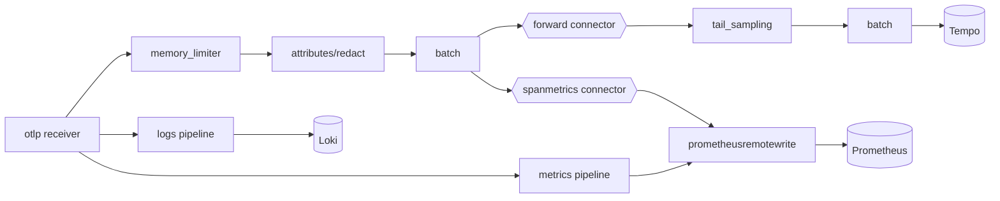

# The shared stack

One small stack serves every use case. Source: [`use-cases/stack/`](https://github.com/akashtalole/ai-observability/tree/main/use-cases/stack).

| Component | Role | Version in compose | Retention (demo) |
|---|---|---|---|
| **OpenTelemetry Collector (contrib)** | Single ingest point: redact, derive span metrics, tail-sample, fan out | 0.120.0 | n/a |
| **Prometheus** | Metrics store, recording + alerting rules, exemplar storage, remote-write receiver | 3.2.1 | 90 d |
| **Tempo** | Trace store (TraceQL search, trace-to-logs/metrics) | 2.7.1 | 14 d |
| **Loki** | Log store via native OTLP ingestion; `trace_id` as structured metadata | 3.4.2 | 14 d |
| **Grafana** | Dashboards, Explore, correlations | 11.5.2 | n/a |

Ports: Grafana `3000`, Prometheus `9090`, Collector OTLP `4317` (gRPC) / `4318` (HTTP).

## Collector pipeline



Design choices (all from the handbook's [pipeline guidance](../implementation/collector-pipeline.md)):

* **Metrics before sampling.** `spanmetrics` sees 100 % of spans, so rates and percentiles are unbiased; only the *trace bodies* are sampled.
* **Tail sampling keeps what matters:** every error, every slow (>8 s) trace, every trace flagged by cheap deterministic checks (`eval.flagged`), plus a baseline slice (25 % in the demo; use 1–10 % in production).
* **Redaction as a safety net**, not the primary control. Apps already send IDs, lengths, scores and versions only.
* **Exemplars on:** histogram buckets carry `trace_id`, which is what makes a latency panel clickable.
* **Self-observability:** the Collector exposes its own metrics on `:8888`; `platform.yml` alerts on export failures, refused data and queue saturation.

```yaml title="use-cases/stack/otel-collector.yaml"
--8<-- "use-cases/stack/otel-collector.yaml"
```

## Prometheus

Metrics arrive by **remote write** from the Collector (`--web.enable-remote-write-receiver`). With `resource_to_telemetry_conversion`, OTel resource attributes become labels: `service_name`, `deployment_environment`, `service_namespace`. OTel dotted metric names become Prometheus names: counter `rag.requests` → `rag_requests_total`, histogram `rag.ttft` (unit `s`) → `rag_ttft_seconds_bucket`.

```yaml title="use-cases/stack/prometheus/prometheus.yml"
--8<-- "use-cases/stack/prometheus/prometheus.yml"
```

!!! note "Collector self-metric names"
    Collector v0.120 exposes self-metrics **without** the `_total` suffix (for example `otelcol_receiver_refused_spans`). Names have changed between Collector releases; check `curl :8888/metrics` after upgrading.

## Tempo and Loki

```yaml title="use-cases/stack/tempo/tempo.yaml"
--8<-- "use-cases/stack/tempo/tempo.yaml"
```

```yaml title="use-cases/stack/loki/loki.yaml"
--8<-- "use-cases/stack/loki/loki.yaml"
```

Loki's OTLP endpoint indexes only a handful of resource attributes as labels (`service_name`, `deployment_environment`, …); everything else, including `trace_id`, `severity` and your `extra={...}` fields, is **structured metadata**: filterable with `| trace_id="…"` without exploding label cardinality.

## Grafana provisioning

Datasources are wired for the correlations described on the [overview](index.md#one-request-all-three-signals).

```yaml title="use-cases/stack/grafana/provisioning/datasources/datasources.yaml"
--8<-- "use-cases/stack/grafana/provisioning/datasources/datasources.yaml"
```

Dashboards are **generated** by [`scripts/gen_dashboards.py`](https://github.com/akashtalole/ai-observability/blob/main/scripts/gen_dashboards.py) (JSON committed) so panels stay consistent. Every dashboard:

* KPI tiles use `$__range`, so the same tile answers "last 5 minutes" and "last 90 days"; a second row shows the **change vs the previous period of equal length** via `offset $__range`.
* Time series use `$__rate_interval`, so resolution adapts to the range.
* Overlay **change events** as annotations (the demo reads "scenario change" log lines from Loki; in production, write deploy / prompt / model / index events from CI/CD).
* End with logs and TraceQL tables for triage.

## Long-range trends (months)

Out of the box this stack keeps **90 days** of metrics and **14 days** of traces and logs. To reach the handbook's 6–18 month goal:

| Need | Option |
|---|---|
| Months of metrics, same Grafana/PromQL | Replace/extend Prometheus with **Mimir**, **Thanos** or **VictoriaMetrics** (remote-write target is one env var in the Collector) |
| Cheap long-range aggregates | Keep the **daily recording rules** (`rag:*:ratio_1d`, …): they are tiny and drive the `*-trends` dashboards |
| High-cardinality slicing (tenant × prompt × index) | Add a **ClickHouse** exporter and the wide-fact table from [Storage & retention](../architecture/storage-and-retention.md) |
| Trace/log retention beyond days | Object-store backends for Tempo/Loki (S3/GCS/Azure) with compactor retention |

## Scaling and hardening checklist

- [ ] Run the Collector as agent + gateway tiers; use the load-balancing exporter (key: `trace_id`) in front of tail sampling.
- [ ] Persistent queues on Collector exporters; alert on `OtelCollectorExportFailing`.
- [ ] Replace anonymous Grafana admin with SSO and RBAC; scope data sources per team/tenant.
- [ ] Move Tempo/Loki/Prometheus to object storage and HA; or adopt Grafana Cloud / managed equivalents.
- [ ] Lower tail-sampling baseline to 1–10 %.
- [ ] Put alert rules in Grafana Alerting or Alertmanager with routing to PagerDuty/Slack (the demo only evaluates rules).
